# Siren: Product Design

## Vision

Siren is a provider-agnostic work-orchestration system that turns approved conversation context into clear, trackable delivery work. It addresses inconsistent work-item quality and requirements buried in chat, then coordinates human review and correlates progress through development, testing, and release. Customers can integrate the chat, project-tracking, source-control, build/test, and deployment/release products they already use.

The goal is better-documented work and fewer avoidable clarification loops, not monitoring for its own sake. Siren should make the path from a relevant conversation to a useful work item predictable, transparent, and reviewable.

## Problem

- Work items vary in completeness and structure.
- Important requirements and context are often shared in chat but never recorded in the work-tracking system.
- Developers discover missing information after work has begun, causing delays and rework.
- Teams need a lightweight way to distinguish a quick investigation from a fully defined initiative without imposing the same process on every request.

## Product FAQ and Positioning

### Why doesn't Azure DevOps already do this?

Azure DevOps already provides substantial work-management and delivery capabilities: work items and process templates, boards, rules and required fields, repositories, branches, commits, pull requests, builds, tests, deployments, dashboards, APIs, service hooks, and extension/integration options. Depending on how an organization has configured Azure DevOps and its existing connectors, some or even much of Siren's proposed functionality may already be available.

Siren should not claim that Azure DevOps cannot do these things. The design hypothesis is that teams may still lack a cohesive, configured path that starts with work requests in chat, guides the request into the right project-specific work-item shape, schedules and records human review, then correlates approved work to repository and release events while measuring phase time. Each connected provider remains authoritative for its own records; Siren orchestrates the cross-system workflow, applies the organization's intake/governance profiles, and provides a consistent end-to-end view.

### What would Siren do that Azure DevOps and existing integrations don't?

The intended differentiators are:

- **Conversation-to-work origination:** begin from an explicitly selected or approved chat context, preserve source references, classify the request, and ask for missing information before creating an item.
- **Context-sensitive item shaping:** apply a versioned project/work-category profile for the selected tracker type, fields, tags, estimate policy, comments, checklists, and milestone template, instead of expecting requesters to know the destination process.
- **A consistent human gate:** schedule reviewers and capture explicit approve/request-changes decisions before development; overdue reminders do not silently approve or advance work.
- **Event-driven lifecycle orchestration:** correlate work-item, branch, commit, PR, merge, build/test, deployment, and release identifiers; maintain a system-managed board/timeline without manual card movement.
- **Cross-phase measurement:** calculate timing from the configured chat/manual origin through review, refinement, planning, development, testing, demo, and deployment, while showing linkage coverage and uncertainty.
- **Portable deployment and configurable governance:** offer the same Rails/PostgreSQL product for Siren-hosted Azure or customer-managed on-prem deployment, with customer-owned profiles and milestones.

These are product hypotheses, not proven market gaps or exclusive capabilities. Azure DevOps custom processes, extensions, Service Hooks, Power Automate, Marketplace tools, or existing internal services may already cover parts of this workflow. The same is true for other providers' built-in workflows and integrations. During discovery, map each requirement to the customer's actual toolchain and existing integrations. Prefer configuring or extending what the customer already operates when it meets the need; build Siren functionality only for the remaining cross-system gap. Siren should complement, not replace, a customer's project tracker, source control, build/test, or deployment systems.

### How will we know the extra system is worth it?

For each pilot customer, document the current process and tools, identify where requests become incomplete or disconnected, and measure a baseline. Compare the pilot on work-item completeness, clarification/rework, time from origin to approval and release, reviewer effort, missed/unlinked delivery events, and user acceptance. Also count setup, maintenance, permissions, and integration overhead introduced by Siren. Continue investment only where the end-to-end improvement is material and the customer prefers the unified workflow over native ADO configuration or existing integrations alone.

## Product Principles

1. **Capture with consent.** Chat access is explicitly approved and scoped. Begin with volunteers and a small allowlist; do not assume access to private messages or channels.
2. **Assist, do not silently file.** Siren proposes a summary and work-item fields for a person to review. Automatic creation or editing requires an explicitly approved policy.
3. **Right-size the process.** Ask for the minimum information appropriate to the work type, while making gaps visible before implementation.
4. **Make decisions explainable.** Show the conversation context used, the fields inferred, and the missing information that led to a quality warning.
5. **Keep humans accountable for judgment.** A person can correct, dismiss, or override a recommendation. Escalations should report unresolved process items, not infer individual performance.
6. **Use platform-neutral concepts.** Keep conversation ingestion and work-item workflows behind adapters so additional chat and tracking platforms can be added without redesigning the core.
7. **Remain provider-agnostic.** No chat, project tracker, source-control, build/test, or deployment vendor defines Siren's domain model or workflow semantics. Microsoft Teams and Azure DevOps are the first planned adapter set, not hard dependencies; additional third-party adapters can be built against documented provider contracts.

## Users and Roles

- **Requester:** raises a need in an approved chat space and answers follow-up questions.
- **Analyst or business analyst:** reviews the conversation summary, fills gaps, selects the work-item type, and starts or dismisses the workflow.
- **Developer or delivery team:** consumes the resulting work item and its supporting context.
- **Kickoff reviewer:** receives a scheduled review request, responds with approval or requested changes, and may provide a final accountable decision if assigned that role.
- **Delivery owner:** confirms readiness to start and configures the team's required review roles, engineering signals, environments, and release milestones.
- **Business owner:** receives an escalation when a required correction remains unresolved beyond the agreed service-level agreement (SLA).
- **Siren administrator:** configures platform connections, approved users and channels, retention, workflow policies, and escalation rules.

## Core Workflow

1. A user invokes Siren from an approved conversation in a connected chat provider using an explicit trigger, or (in a separately approved later phase) receives a suggestion from an enabled detection rule.
2. An explicit trigger starts the intake flow. A proactive suggestion only offers **Start work item** or **Dismiss**; it does not capture an expanded context, call the drafting model, or create a work item until the user selects **Start**.
3. If started, Siren captures the triggering message and the permitted thread or bounded recent-message context, then produces a draft title, description, keywords, and relevant supporting context.
4. Siren classifies the likely work context and selects the applicable, approved project work-item profile. The profile maps the normalized Siren draft to the connected tracker provider's work-item type and field/tag/comment rules.
5. Siren identifies which profile-required information is present, uncertain, or missing. It asks focused questions rather than inventing values such as effort estimates.
6. The analyst confirms or changes the work category/profile and reviews the profile-shaped draft, including tags, estimate policy, and any prefilled comment.
7. Siren validates the draft against the selected profile and destination tracker's discovered schema. The authorized person confirms creation or update.
8. Siren retains a dismissal for one week, then may ask again if the request still appears relevant. The system must provide a way to change this interval and honor a user's opt-out.
9. After submission, Siren can check for missing information required by the selected profile. Potential quality issues enter a daily human review queue. Work should not be marked ready to start until agreed blockers are corrected or explicitly waived by an authorized person.
10. Items unresolved beyond the configured SLA are reported to the responsible business owner with the missing information, age, and prior actions.
11. After the work item is created in the connected tracker, Siren creates a kickoff review with required reviewers, a review-by time, and a decision policy; it sends configured reminders and can optionally schedule a calendar meeting.
12. Reviewers approve, request changes, abstain, or mark their role not applicable. Only an authorized final approval moves the item to `ready_for_development`; overdue or unanswered review requests remain pending and escalate rather than auto-approving.
13. During development, Siren tracks linked events from the configured source-control, build/test, and deployment/release providers in a source-linked timeline, showing configured target environments and stale-feed status. Each provider remains authoritative for its own artifacts; Siren does not infer completion from activity volume.

## Delivery Lifecycle Automation

Creating the work item in the connected project-tracking provider is the handoff into delivery, not the end of Siren's workflow. Siren coordinates the kickoff review and follows linked delivery evidence through development, testing, deployment, and release. Each connected provider remains authoritative for its own records; Siren stores review decisions and a normalized, source-linked timeline for coordination and visibility.

### Zero-Manual-Board-Management Principle

The work board is a **system-generated projection**, not a workflow users are expected to maintain by dragging cards or manually changing phases. Siren originates the work item after the authorized intake action, schedules human review, and updates its projection only from an authorized human decision or a configured, correlated source event. The human remains responsible for approval, requested refinement, and explicitly human-owned milestones; people do not have to copy messages into tickets or manually keep board columns synchronized with branches, PRs, builds, tests, deployments, and releases.

The board/timeline shows the current phase, next responsible action, due date, source event or human decision that caused the last transition, linked provider artifact, and synchronization freshness. If evidence is missing or ambiguous, show **Needs attention** or **Unknown/stale** rather than asking users to drag the item to the phase they think it belongs in. An authorized correction/reconciliation action may repair an erroneous transition, but it records actor, reason, previous value, and audit history; it is not routine board tending.

Track delivery state separately from draft/intake state. The initial Siren delivery states are `awaiting_kickoff_review`, `changes_requested`, `ready_for_development`, `in_development`, `in_test`, `deployed`, `released`, `blocked`, and `cancelled`. A project may map these to Azure DevOps states or fields, but Siren must preserve its own review decision and explain the mapping. **An item or milestone moves only when an authorized human action or an explicitly configured, correlated source event occurs.** Timers, elapsed-time thresholds, missing telemetry, model inference, dashboards, and reminder/escalation jobs never transition workflow state. A due-time breach may notify/escalate, but the milestone remains in its current state until an allowed action/event changes it.

### Management-Configured Milestones and Phase Timing

The lifecycle shown below is a starter template, not a fixed Siren workflow. Management and authorized project owners can define the milestones **exactly as their organization names and orders them**, from the original direct-message request or manual ticket creation through intake, human review, approval, refinement, development planning, implementation, testing, demo/UAT, deployment, and release. They can add, rename, reorder, make optional, or omit milestones for each project/work-item type without changing application code.

A starter template could be: **Request origin** (Teams direct-message timestamp or manual ticket creation) → **Siren intake started** → **Work item created** → **Refinement complete** → **Kickoff review scheduled** → **Human review approved** → **Development planning complete** → **Development started** → **Pull request approved/merged** → **Testing passed** → **Demo/UAT accepted** → **Deployment to each configured environment** → **Production release** → **Work item closed**. This is a suggested baseline only; management may split phases (for example, separate QA and security review), combine them, define different environments, or use their own vocabulary.

Each versioned milestone template defines:

- Scope: organization, Azure DevOps project, work-item type/category, and any applicable size or risk conditions.
- Milestone key and display name, sequence/order, description, required/optional status, and dependencies or allowed transitions.
- Entry and completion rules: explicit Siren action, authorized reviewer decision, Azure DevOps work-item state/field change, linked branch/commit/PR/merge/build/test/deployment/release event, or a configured combination. Every rule names its authoritative source, required correlation fields, and event mapping. A clock/SLA condition can raise an alert but cannot complete or advance a milestone.
- Optional target duration/SLA, reminder and escalation policy, business calendar, working hours, time zone, holidays, and whether paused intervals count toward the target.
- Whether a phase may be repeated/reopened and how each iteration is represented; whether its time is measured per attempt, cumulatively, or both.
- The **clock origin** used for reporting: source message timestamp for an authorized Teams/Slack request, manual ticket/request creation timestamp, or another explicitly configured event. Keep the original source timestamp, provider-received/detected timestamp, Siren intake-start timestamp, and Azure DevOps creation timestamp separately; do not substitute one for another.

When a work item enters Siren, attach the currently active template version and instantiate its milestones. Later template changes affect new work by default; re-baselining an in-flight item requires an authorized, audited action and preserves its original template and timestamps. A milestone becomes complete only from its configured authoritative signal or an authorized human confirmation. Missing telemetry is displayed as unknown/stale, never guessed from a nearby commit or inferred from elapsed time.

For each milestone and each transition, append an event with the exact observed UTC timestamp, actor/system source, provider artifact reference where applicable, prior/new state, and template/rule version. Record pause/resume intervals and reasons (for example, waiting on requester, external approval, or an environment outage) without deleting wall-clock time. Reopened work starts another attempt/iteration linked to the same milestone, preserving both individual attempt time and total cumulative phase time.

Reports calculate request-to-milestone duration from the template's chosen origin event and phase duration from each milestone's recorded entry/completion pair. Show both raw elapsed time and the business-calendar duration; show paused/waiting intervals separately and apply exclusion only when the template explicitly requests it. Preserve the actual event timestamp, provider observation/ingestion timestamp, and manual correction timestamp where applicable. If an origin or completion timestamp is unavailable, label that interval incomplete; do not backfill a synthetic timestamp without an audited correction and provenance.

The console provides management a milestone-template editor with preview against sample work items, validation for impossible dependencies/cycles, versioning, approval, effective dates, and rollback. Operational reports show, by configurable project/work type/cohort:

- Elapsed time from the selected origin to every milestone entry and completion.
- Time spent within each phase, including per-attempt and cumulative rework time.
- Wall-clock elapsed time and business-calendar time, with paused/waiting time shown separately rather than silently excluded.
- Median/percentile distributions, target-versus-actual, overdue counts, and sample size; missing/stale event coverage is explicit.

These are process-flow measures, not employee scorecards. Default reporting is aggregated by workflow/project and phase; do not rank individuals by response, commit, PR, or phase duration. Exact timestamps describe observed system events and can still be delayed by provider delivery or clock/permission limitations, which the UI must disclose.

### Kickoff Review and Scheduling

After an approved work item is created, Siren creates a **kickoff review** with a configured review-by date/time, reviewer roles or named participants, and the expected decision. Review can be asynchronous by default: assign the reviewers, notify them that a review is due soon, and collect each person's response in Siren. A calendar meeting is optional when the work requires discussion; do not make calendar integration a prerequisite for review.

- Select reviewers using project/work-item policy (for example, product/business owner, analyst, technical lead, or delivery owner). Resolve actual participants before sending notifications and show the requester who has been asked to review.
- Notify through the configured channel, initially a private Teams notification or an approved email path. Include the work-item link, requested action, review-by time, and Siren link; exclude raw source messages by default.
- Support a review due window, reminders before the deadline, an overdue escalation, and rescheduling with a recorded reason. Avoid repeated or broad channel notifications.
- If a calendar kickoff is useful, create an optional Teams/Outlook calendar event with Graph Calendar APIs only after calendar permissions and organizer behavior are approved. Store its external event ID and link; handle updates/cancellations and do not expose private attendee details unnecessarily.
- Keep individual responses visible: `pending`, `approved`, `changes_requested`, `not_applicable`, or `abstained`. A configured accountable approver records the final decision; a quorum or required-role rule may be used where the organization needs multiple approvals.
- On **changes requested**, the item returns to the named owner with findings and a response deadline. The owner updates the work item through its tracker adapter; Siren records the new version/state and schedules re-review where policy requires it.
- On **approved**, Siren records who approved and when, then moves the delivery workflow to `ready_for_development` (or the configured equivalent). Only authorized roles can approve; no model score or automated inference can approve kickoff.
- If the review deadline passes, Siren sends reminders/escalations according to the configured SLA. An overdue review does not silently become approved and does not automatically start development.

Siren may set or synchronize a tracker state/custom field only when the provider mapping is configured and approved. The canonical review schedule, participants, responses, and audit history remain Siren-owned; the tracker item holds a link or summarized status as appropriate.

### Development, Test, Deployment, and Release Tracking

After kickoff approval, Siren builds a timeline by correlating the tracker work item with linked engineering and delivery artifacts from the configured providers. Use provider webhooks/service hooks where available, with provider API reconciliation to detect missed or delayed events. Re-check permissions before reading artifacts and store only the metadata needed for the timeline.

#### Identifier and Correlation Chain

Reliable end-to-end measurement depends on stable provider identifiers and validated relationships. At work-item creation, Siren must retain the tracker provider key, provider-scoped work-item ID, organization/project scope, and URL. Every tracked artifact must have its provider key, provider-scoped identity, and parent/source relationship recorded. The configured chain is:

`organization/project + work_item_id` → `repository_id + branch_ref` → `commit_sha` → `pull_request_id` → `merge_commit_sha + target_branch` → `build_id + source_version` → `test_run_id + build/artifact_id` → `deployment_id + environment_id/name + artifact_id` → `release_id or production deployment_id + live_as_of timestamp`.

The provider-scoped work-item ID may be associated directly on a branch/PR/build/deployment, or inherited through an explicitly validated parent relationship (for example, a PR references a work item and a build source version equals the PR merge commit). Siren records the provider key and exact path used to associate each artifact to the work item. A name match, nearby timestamp, author identity, or similar text is not sufficient correlation by itself.

If a stable ID or required relationship is missing, the activity may appear as unlinked/unattributed, but it must not advance the work-item state or be counted as a confirmed phase completion. Mark downstream metrics **partial coverage / not measurable** and identify the missing link. An authorized user may explicitly associate an artifact to a work item; record who linked it, when, and why. Do not synthesize IDs or silently infer the association.

For a production release, record the deployment/release identifier, immutable artifact/version or commit SHA, target environment identifier, deployment completion time, and the `live_as_of` timestamp confirmed by the deployment source or authorized release owner. Show when the latest environment was observed, not merely when it was expected to be live.

Siren can report recent linked activity for a work item or project (for example, counts and timestamps of commits, PR updates, builds, tests, and deployments over a time window) as workflow telemetry. Do not label raw commit counts or individual-author activity as productivity or work-rate scores; present aggregate activity with its linkage coverage and avoid ranking people.

Track these milestones when the project has the relevant Azure DevOps services enabled:

- **Origination:** an explicit request from a connected chat provider or manual ticket creation records the origin event and clock anchor. When the tracker item is created, Siren must persist its provider-scoped ID, organization/project scope, and URL before claiming downstream tracking coverage. Creating the Siren/tracker work item is a separate configured event and does not overwrite the origin time.
- **Human review and approval:** an authorized reviewer action moves the review milestone to approved or changes-requested. Scheduling, notifications, and due dates do not imply a decision.
- **Development planning:** an authorized planning-complete action or configured Azure DevOps planning-state event advances this milestone; branch activity alone does not imply that planning was approved.
- **Branch and commits:** branch creation can start development when it is linked to the work item and matches the configured repository/branch policy. Commit events on that linked branch append activity and may trigger a specifically configured milestone, but do not repeatedly move the overall state on every commit. Do not copy full diffs or source files into Siren.
- **Pull request:** a PR must be linked to the work item and source branch. PR creation may move the item to review; review decisions and merge are separate events. The configured source-control provider is authoritative for PR and commit details.
- **Merge and build/test:** a merge into the configured target branch records the merged commit. A build counts as the build for that merge only when its source version corresponds to that merge commit (or an explicitly configured equivalent); tests must link to the corresponding build/artifact. Only the configured result, such as successful required checks, can advance the matching milestone.
- **Deployment and release:** deployment/release records must correlate to the same merged commit or its resulting build/artifact and match the configured environment. Each environment transition is its own event/milestone when configured. A production release event may complete release; deployment to a lower environment does not.
- **Closure:** a human action or configured authoritative Azure DevOps state/release event closes the workflow. Siren does not infer “done” from inactivity, the last commit, a successful non-production deployment, or an elapsed target date.

The admin/project configuration defines which tracker organizations/projects, source-control repositories/target branches, build pipelines, test plans, environments, deployment systems, and event types Siren may observe, and which milestones are required versus informational. Each transition rule specifies provider-scoped correlation requirements (for example, tracker work-item ID, repository ID, source branch, PR ID, merge commit SHA, build source version, and deployment artifact/environment). If linkage is ambiguous, events are recorded as uncorrelated activity for review and do not move the item. The user-facing work-item timeline should show provider, source, timestamp, artifact link, environment, status, and last synchronization time. Mark stale or incomplete feeds visibly; never display missing events as evidence that no work occurred.

Service Hook deliveries may be duplicated or arrive out of order. Deduplicate by provider event/artifact identity, retain the provider's occurred time separately from Siren's observed time, and evaluate current milestone state plus required predecessor events before applying a transition. If a prerequisite is missing, keep the event as pending/unmatched for reconciliation or human review; do not skip phases or rewrite history to force a linear sequence. A later authoritative reconciliation can apply the transition with its actual event timestamp and an audit trail, if the configured rule still passes.

Progress alerts should be event- and policy-driven (review due/overdue, PR awaiting review, required check failed, deployment awaiting approval, test failed, release completed, or work item stale). Alerts are side effects only and never advance the item. Let teams configure recipients, quiet hours, thresholds, and escalation rules. Do not rank people or treat commit counts, branch age, or PR volume as employee-performance measures.

## Trigger and Conversation Capture

### Teams-first pilot

Microsoft Teams is the first conversation source. The initial experience should be explicitly user-initiated, making the capture boundary visible and avoiding a dependency on broad passive monitoring. Candidate trigger mechanisms are:

- **Bot mention:** a user mentions the Siren bot in a message and asks it to start a work-item draft. This is discoverable in conversation, but the exact bot behavior and message visibility depend on the Teams app installation scope and tenant configuration.
- **Message action:** a user invokes a Siren action on a specific message, such as from the message's actions menu. This gives the clearest source-message anchor, if supported by the chosen Teams app pattern and tenant policy.
- **Personal app or command:** a user opens Siren directly and pastes text or selects a conversation reference. This is the fallback when message actions or bot access are unavailable.

For the pilot, implement one supported in-context trigger plus manual entry. Prefer a message action when feasible because it binds the request to an exact message; otherwise use a bot mention with an explicit prompt to start. Validate Teams app capabilities, installation scopes, permissions, and admin consent in the target tenant before finalizing the trigger. A hashtag alone is not the MVP trigger: Siren may not receive arbitrary messages merely because they contain a tag.

### Ways users start a workflow

Offer several entry points over time, all creating the same `capture_request` and normalized capture envelope:

- **Message action (preferred in-context entry):** an analyst or requester selects a Teams message and chooses **Create Siren work item**. The selected message is the clear source anchor.
- **Bot mention or command:** a user mentions Siren with an explicit instruction such as `@Siren draft a work item`. Siren asks for confirmation and identifies which message/thread context it proposes to use.
- **Personal app / create screen:** a user starts a draft, chooses a permitted conversation context if supported, or pastes a short excerpt and adds context manually. This is the reliable fallback when the bot cannot read the thread.
- **Proactive suggestion:** only in a later, explicitly approved opt-in mode. Siren displays a low-pressure card or private bot message on a likely request; the user must choose **Start** before Siren expands context or invokes the drafting model.
- **Future provider entry points:** Slack message actions, app mentions, or slash commands map into the same workflow while retaining provider-specific permissions and semantics.

The explicit entry points should be available before proactive detection. Users must be able to find Siren from the Teams app, see how to invoke it, and start from manual text without waiting for the classifier to notice them.

### Candidate detection and proactive suggestions

Candidate detection answers only “might this conversation contain a request for work?” It is separate from authorization, capture, classification, and draft generation. A detected keyword is a weak signal, not proof of intent or permission to monitor or process the conversation.

The MVP uses explicit triggers only. After the Teams pilot and a separate privacy/security/tenant approval, Siren may support opt-in proactive suggestions in specifically allowlisted Teams scopes. Proactive detection must not be enabled merely because the bot has been installed or because an administrator configured a keyword.

#### What proactive listening requires

To notice an **untagged** keyword or request in a conversation, Siren must receive message content from that conversation somehow. There is no way to guarantee detection of arbitrary messages without either a provider-supported message event feed or periodically reading messages in the enabled scopes. Therefore, broad detection means ongoing message processing within each authorized scope; it is not equivalent to the explicit-trigger MVP.

This does **not** automatically mean Siren must permanently store every message, send every message to an LLM, or create a capture request for every message. Separate these stages:

1. **Provider delivery:** Teams/Graph delivers message-change notifications for the specifically subscribed and authorized resources, or an approved polling mechanism retrieves messages. The set of resources determines what Siren can possibly detect.
2. **Transient signal evaluation:** a lightweight deterministic rule scan evaluates eligible message text in memory or another tightly controlled transient path. Apply exclusion/opt-out policy before content evaluation wherever the provider and integration model allow it.
3. **Candidate record:** only a minimal match/suppression record is persisted when needed to avoid duplicate suggestions and support audit (source reference, matched rule IDs, timestamps, and policy version). Do not persist full message bodies merely to remember a keyword match.
4. **User-confirmed capture:** only after the user selects **Start** does Siren retrieve the permitted bounded thread/context, create the normal capture request, and run full classification/drafting.

If the business requirement is “find likely work even when nobody invokes Siren,” then message-level event delivery (or polling) across the approved Teams channels/chats is functionally necessary. If that access is not approved, the honest alternatives are message actions, bot mentions, explicit commands, manual paste, and possibly an opt-in user-submitted forwarding/share action; these detect only work that a person brings to Siren. A hashtag can reduce false candidates but cannot remove the need for a feed if Siren must notice that hashtag without being invoked.

Teams support, Graph endpoints, permission types, tenant consent, resource-specific consent availability, change-notification lifecycle/renewal, notification payload contents, throttling, and message-history access vary with the selected app pattern and tenant. Do not assume a bot installation grants comprehensive channel or private-chat access. The integration spike must prove the exact production-intended subscription/read path in the target tenant. The design should state detection coverage per resource type (channel, group chat, one-to-one chat) and explicitly list unsupported contexts. Event feeds may be delayed or incomplete; define renewal, health monitoring, retry, and any permitted reconciliation mechanism. Do not silently broaden access to fill gaps.

Because messages are processed before a user accepts a suggestion, proactive mode requires organization approval and participant notice/consent as applicable even if raw content is not retained and no LLM is called. Scope it narrowly by tenant, conversation type, named channels/chats, and volunteer participants; provide a documented off switch and deletion/retention policy. Do not enable private-chat listening by default. If any required permission, notice, or feed-health condition is absent, disable proactive detection and retain explicit-trigger/manual intake.

Use a staged detector to limit cost and false prompts:

1. **Eligibility filter:** application code checks that the tenant, conversation type, channel/chat, participants, user preferences, and policy version are approved for proactive detection. If any check fails, the message is not evaluated.
2. **Deterministic signal scan:** configurable, versioned keyword/phrase rules identify possible work signals, such as an explicit request (`could we`, `please add`, `need a way to`), an incident/defect (`broken`, `failing`, `can't access`), or a customer/business impact (`customer blocked`, `manual workaround`, `deadline`). Terms are examples, not a universal dictionary. Apply language-aware word boundaries, exclusions, and allowlisted contexts; do not trigger on a keyword alone when it appears in negation, quotation, documentation, or unrelated discussion.
3. **Context and intent check:** if rules match, an inexpensive classifier may inspect only the authorized message/thread window to distinguish actionable requests from discussion, status updates, hypotheticals, and quoted text. Do not run a full draft-generation prompt on every observed message. If model use is not approved, use rules only and show a conservative suggestion.
4. **Suggestion threshold and suppression:** notify only when the configured signals meet a pilot-calibrated threshold. Suppress duplicates for the same candidate/thread, respect user dismissals and opt-outs, and cap suggestions per person/conversation/time period. Low confidence means no prompt, not more aggressive scanning.
5. **User confirmation:** show a concise reason, such as “This message mentions a customer being blocked and asks for a change.” The user can inspect the source, select **Start**, **Dismiss**, or **Not a work request**. A start action moves into the normal capture preview and explicitly confirms which additional context will be sent for drafting.

Rules are organization/project scoped, versioned, and editable only by authorized administrators. Changes that broaden monitored scopes, add proactive detection, or materially increase processing require privacy/security approval and the appropriate second-person approval. Start in shadow mode with volunteers: record eligible detection outcomes and reviewer/user feedback without sending prompts, then review precision and missed cases before enabling suggestions. Detection data and metrics must follow the same retention and privacy constraints as other conversation-derived records.

Every suggestion must be dismissible, explain why it appeared, and offer a user-level opt-out where policy allows. Dismissals should suppress the same candidate for the configured interval and should not be used as performance signals. Avoid public callouts or repeatedly posting a bot card into group conversations; prefer private notification to the initiator when the Teams integration supports it. If the integration cannot deliver privately, require explicit design approval before using a visible group response.

### Detection versus capture boundary

Proactive detection requires a provider-supported message feed or polling within the scopes Siren is expected to monitor; it cannot discover arbitrary untagged messages without receiving them. This message-level processing is separate from durable capture: the detector should scan transiently, avoid storing complete messages, and retain only minimal candidate/suppression metadata where required. It still requires explicit platform-owner/privacy approval, a defined scope, participant notice where required, and a documented retention policy. **Start** is the user's consent to begin the Siren work-item intake from the suggested source; it does not replace organizational authorization for the earlier detector. After **Start**, Siren rechecks authorization, previews the exact context, and only then retrieves any additional context and performs full classification and draft extraction.

For proactive mode, retain only the minimum necessary detector outcome (for example, source reference, matched rule IDs, policy version, timestamp, and suggestion/dismissal state) for the approved suppression/audit period. Avoid storing full message bodies in the detection layer. Recheck permissions and source availability before the user starts; if the message was edited, deleted, or access was revoked, refresh the allowed context or invalidate the suggestion.

The trigger should make the next step legible in the conversation: acknowledge that Siren can prepare a draft from the selected context, identify the source conversation, and offer **Start**, **Dismiss**, and **Cancel** where applicable. Do not post a generated summary back into a group thread by default; provide the draft privately to the initiating user or analyst unless they choose to share it.

### Capture boundary and context window

The capture boundary starts with the selected message or explicit command, not with an open-ended request to read a user's conversations. After **Start**, Siren may gather additional context only within the same authorized conversation and the configured limit. Initial policy:

- Use a **30-message maximum context window by default**, configurable by an authorized administrator and adjustable for the specific request before processing. For an unthreaded chat/channel message, the window is the triggering message plus up to the 29 immediately preceding messages in that exact conversation, ordered chronologically. For a bot mention/command, the invocation message is the anchor and counts toward the same limit. This handles conversations where participants did not create a thread.
- If the trigger is a message inside a Teams thread, include that thread's root and available replies around the anchor, up to the same total 30-message cap. Do not silently combine the thread with unrelated messages from the parent channel. If the thread/root is unavailable, use the visible authorized anchor and ask the user to add context.
- Apply a maximum lookback age as well as the message-count limit so a low-volume conversation does not pull very old context. Proposed default: seven days before the anchor; the administrator may configure this, and the UI shows when older context was excluded.
- For an older message selected through a message action, anchor the window at that selected message and include only earlier messages, not later conversation that would not have been available at the time of the request. A reviewer may explicitly add later messages in the preview if they clarify the request and are in the same authorized scope.
- Preserve message order, authorship references, timestamps, and reply relationships. Exclude provider system events and messages Siren is not authorized to process; show the effective selection and any exclusions/truncation in the scope preview and audit manifest.
- Never cross between a channel and a private chat, between two chats, between tenants, or across any other provider conversation boundary to fill the window. The context window is a maximum, not a requirement to include every available message: the user can remove optional messages or supply a concise manual summary.
- Do not fetch unrelated channel history, the user's other chats, or messages outside the approved retention/access scope.
- If the trigger is a channel message but the bot cannot access the thread or surrounding messages, proceed with the selected message only and ask the user to add context or paste relevant details.
- If the request depends on an attachment, link, image, or document that Siren cannot safely and permissibly retrieve, show it as unavailable and ask for a concise description; do not imply it was analyzed.
- Clearly show the context mode (thread or recent conversation), number of messages included, time span, anchor message, and any truncation or unavailable content before the user confirms capture.

The administrator-configured message cap and lookback age, plus the actual selected source IDs, must be recorded in the scope manifest and audit metadata. Start with 30 messages and seven days, then adjust using pilot evidence about missed references versus unnecessary capture. A user may cancel before processing; cancellation stops further retrieval and model calls where technically possible.

### Intake interaction

1. **Invoke:** the user selects the Teams message action, mentions the bot, opens the personal app, or (in approved proactive mode) accepts a suggestion.
2. **Preview scope:** Siren identifies the source (team/channel or chat, thread/message, timestamp) and the additional context it proposes to include. It provides a way to remove optional messages or add context manually.
3. **Confirm capture:** the user selects **Start**. If the source is outside the approved allowlist or cannot be authorized, Siren explains that it cannot process the context and offers manual entry where allowed.
4. **Classify and draft:** the authorized context enters the LLM pipeline below. Siren returns a private draft to the initiating user or designated analyst, with citations or links back to source messages where supported by permissions.
5. **Resolve gaps:** the reviewer answers focused questions, edits the work-item fields, or dismisses the draft. Siren records dismissal against the source/thread for the configured period to avoid repeatedly prompting on the same request.
6. **Submit:** only an authorized reviewer confirms the final work item for Azure DevOps. Submission and subsequent sharing are separate explicit actions.

For an explicit trigger, dismissal applies to that candidate/thread, not to all future messages from the person. The default one-week reminder behavior from the vision should apply only when the same unresolved candidate is still relevant; it must be configurable, visible, and suppressible by the user. Avoid recurring prompts when there is no new evidence or action needed.

### Source and consent controls

- Register the Teams app only in approved tenant scopes and begin with the system owner and named volunteers. Do not treat a bot installation as blanket permission to process every message visible to it.
- Separate authorization for personal chats, group chats, and channels. The allowed scope, initiating user, and any required participant notice must be checked before retrieval and again before processing.
- Make it clear to participants when Siren is present and when content is being submitted for analysis. Establish organization-approved notice and consent practices before enabling group or private conversation capture.
- Keep a record of the initiating user, source IDs, scope used, capture time, context-window policy version, processing status, and reviewer actions. Avoid retaining raw chat text longer than needed under the approved retention policy.
- Honor edits, deletions, revocation, and cancellation according to the provider's capabilities and the organization's retention rules. If the source is deleted or access is revoked before submission, invalidate the draft or require a fresh review rather than silently retaining inaccessible context.
- Provide a manual-entry path that does not require connecting a conversation source. This is both a fallback and a way to submit content that should not be accessed through an integration.

### Provider-neutral capture contract

The core workflow should not depend on Teams-specific event shapes. Each provider adapter supplies a normalized capture envelope to the same classification and drafting pipeline:

- `provider`: source system identifier, initially `teams`; later may include `slack`.
- `tenant_id` and `conversation_type`: provider/tenant boundary and a normalized value such as `channel`, `group_chat`, or `direct_chat`.
- `conversation_id`, `message_id`, and optional `thread_id`: stable provider identifiers, stored and used only under approved retention and access rules.
- `initiator_id` and `participants`: provider identities needed for authorization, attribution, and reviewer display; minimize participant data sent to the model.
- `messages`: ordered message records with stable IDs, timestamps, author references, text, and supported reply relationships.
- `capture_mode`: `message_action`, `bot_mention`, `manual_entry`, or `accepted_suggestion`; do not create a capture request for a detector match that the user has not accepted.
- `scope_manifest`: exactly which messages and optional artifacts were retrieved, excluded, or unavailable, plus the policy/version that allowed retrieval.
- `source_links` and `capabilities`: whether source links, replies, edits, deletion events, attachments, and message actions are supported for this capture.

The adapter owns authentication, provider permission checks, paging, event normalization, and provider-specific limitations. The core owns policy evaluation, bounded-context rules, candidate classification, evidence mapping, and draft generation. Provider capabilities must be explicit; a Slack adapter should not be assumed to support the same trigger or capture behavior as Teams.

### Adding Slack later

Slack is a later input adapter, not a reason to generalize away Teams' permission model. Add it after the Teams pilot validates the workflow and after separate approval for Slack scopes and data handling. Keep triggers provider-native (for example, a Slack message action, app mention, or explicit command where supported), then convert the selected context into the same normalized capture envelope. Reassess channel versus direct-message access, participant notice, thread retrieval, event subscriptions, and retention independently for Slack. Do not reuse Teams consent or allowlists as authorization for Slack.

## LLM Processing and Classification Layer

The Siren "brain" converts an authorized conversation into a reviewable work-item proposal. It is a staged decision-support pipeline, not a single prompt that reads chat and writes directly to Azure DevOps. Each stage has a narrow responsibility, a typed output, and a way to abstain. Model output is untrusted until validated by application code and reviewed by a person.

### Processing Pipeline

1. **Authorize and normalize.** Verify the source, user, channel or conversation, and requested operation against the current allowlist and consent policy. Normalize provider events into messages with stable IDs, timestamps, authors, thread relationships, and edit/deletion state. Exclude content the integration is not permitted to read. If authorization cannot be verified, stop before sending content to a model.
2. **Build bounded context.** For an explicit trigger, anchor at the selected/invocation message and use the configured context policy (initial default: up to 30 messages and a seven-day lookback) within that same chat/channel or thread. Include only the authorized selection; do not silently expand across conversation boundaries. Mark truncation, excluded messages, and unresolved references. Keep source IDs so generated claims can be traced back to supporting messages.
3. **Detect a candidate.** Classify an authorized context as `not_work`, `possible_work`, or `actionable_work`. This stage should favor abstention over interrupting users. A user-issued command or explicit message action can skip passive candidate detection and begin intake; a keyword or hashtag match by itself can only produce a candidate suggestion after proactive detection is approved. Neither bypasses capture authorization, scope preview, or downstream validation.
4. **Classify the work.** For a candidate, infer a configurable Siren business category and delivery size. Initial categories may include `rapid_response`, `feature_request`, `business_initiative`, `question`, `incident_or_defect`, `small_change`, and `investigation_or_spike`. Keep category separate from size. Return `unknown` when evidence is insufficient; do not force a label.
5. **Resolve the work-item profile.** Deterministic application rules match project, work-item context, and the proposed category to one approved profile version. If there is no unique valid match, ask the analyst to select a profile/category. The LLM may suggest a category with evidence, but cannot choose an arbitrary Azure DevOps work-item type or bypass profile applicability.
6. **Shape and extract the draft.** Produce normalized content, then apply the selected profile's approved ADO type, field mappings, fixed defaults, conditional tags, estimate policy, and optional comment template. Each field is marked `supported`, `uncertain`, `missing`, or `configured_default`; supported claims cite source messages. Never invent a numeric estimate. Only fields whose profile explicitly permits a model suggestion may be proposed by the model, and such values remain visibly unconfirmed.
7. **Check completeness and contradictions.** Apply deterministic required-field and allowed-value rules from the selected profile, Azure DevOps project metadata, and linked checklist version. Detect conflicting statements, stale details, and unanswered questions. The model may explain a potential contradiction, but should not choose a winning statement without confirmation. Separate hard validation failures from advisory concerns.
8. **Ask focused questions.** Ask only for missing values required by the selected profile or questions needed to resolve material uncertainty. Avoid repeating supported information. Allow the requester or analyst to answer, mark not applicable when the profile permits it, or defer with a reason.
9. **Present evidence and obtain approval.** Show the matched profile and version, target ADO type, category, applied defaults/tags, estimate/comment policy, uncertainties, missing fields, and source references. The analyst can change category/profile, edit fields, remove optional tags, or request another draft. Only the confirmed, validated proposal may proceed to Azure DevOps.

### Classification Contract

Every model stage returns schema-validated data rather than free-form text. A candidate decision should include:

- `decision`: `not_work`, `possible_work`, or `actionable_work`.
- `category`: configured category or `unknown`.
- `size`: a configured delivery-size value such as `small`, `medium`, `large`, or `unknown`, kept independent from business category. `rapid_response` is a work category, not a size.
- `confidence`: calibrated score per decision or field, not just one overall score.
- `evidence`: source message IDs and short supporting excerpts for material claims.
- `missing_fields`: required fields with a concise explanation of what is needed.
- `uncertainties`: ambiguous or conflicting facts that require human resolution.
- `suggested_questions`: targeted questions, each associated with the field it resolves.
- `policy_flags`: conditions such as restricted source, sensitive content, or unsupported destination type that require a stop or review.

The application validates allowed enum values, field types, maximum lengths, required evidence references, and project-specific mappings. Invalid or incomplete model output is rejected and retried under a bounded policy; it is never passed through as a work item. Keep a versioned schema and classifier/prompt version on each draft for debugging and evaluation.

### Confidence and Abstention

Confidence is a routing signal, not a truth score. Calibrate it against labeled examples from the pilot, and measure it separately for candidate detection, category, size, and extracted fields. Initial behavior should be conservative:

- High-confidence explicit trigger: start the draft workflow, still requiring analyst confirmation before submission.
- Likely candidate with adequate evidence: offer the workflow without claiming that work is definitely required.
- Low confidence, conflicting evidence, or `unknown`: ask the analyst, or do nothing for passive detection.
- Missing required information: ask targeted questions; never lower requirements merely to make a draft pass.
- Model or provider failure: preserve the conversation reference where permitted and offer manual entry. Do not block the user's ability to create work outside Siren.

Confidence thresholds and the cost of false positives versus missed work should be set from pilot data. Dismissal is a valid outcome and should reduce repeat prompting for the configured period; it must not be interpreted as evidence about an employee's performance or intent.

### Prompt and Data Safety

- Treat chat text, attachments, links, and quoted instructions as untrusted data, never as instructions to the model or Siren. A message asking Siren to reveal prompts, access other conversations, change policy, or create work without approval must not alter system behavior.
- Keep policy, task instructions, and conversation content in separate structured input fields. Use explicit delimiters and tell the model to extract facts only from the supplied context.
- Do not let the LLM choose permissions, expand the message window, select arbitrary Azure DevOps projects, execute tools, or submit work items. Enforce those decisions in deterministic application code.
- Send only the minimum approved context to the selected model service. Document model-provider retention and training settings, regional processing, access controls, and deletion behavior before pilot use.
- Redact or avoid processing sensitive data that is not needed for work-item creation. Define handling for credentials, personal data, regulated information, and attachments before enabling those sources.
- Log stage outcomes, schema/version identifiers, and reviewer actions for audit and debugging, while limiting stored raw message content according to the approved retention policy.

### Model Strategy and Failure Handling

Use the simplest model and pipeline that meets measured quality, latency, privacy, and cost requirements. A small classifier or deterministic trigger can handle candidate detection; a stronger language model can be reserved for structured extraction and question generation. Do not introduce multiple model agents or autonomous tool use unless evaluation demonstrates a concrete benefit.

Keep model access behind a provider interface so hosting or vendors can change without changing workflow logic. Record model name/version, prompt version, input scope, latency, token or usage cost, validation errors, and human edits. Bound retries and output size. On timeout, rate limit, malformed output, or low confidence, fail closed on automation and fall back to manual analyst entry.

### Evaluation and Monitoring

Before expanding the pilot, build a permissioned, representative evaluation set with analyst-labeled examples, including non-work chatter, ambiguous requests, multi-message requests, contradictions, sensitive-content cases, and prompt-injection attempts. Keep evaluation data access and retention governed like production conversation data.

Track at minimum:

- Candidate precision and recall, with false prompts reported separately from missed candidates.
- Category and size agreement with analyst decisions, including the rate of `unknown` and analyst overrides.
- Field-level extraction accuracy and evidence support; unsupported claims should be treated as a critical defect.
- Required-field completeness and the rate of useful versus unnecessary follow-up questions.
- Analyst edit distance or correction rate, time to approve a draft, dismissal rate, and user feedback.
- Schema validation failures, provider failures, latency, and cost per completed draft.
- Differences in performance across approved channels, work categories, and user groups where measurement is appropriate and privacy-approved.

Review samples and failures regularly. Any change to prompts, models, schemas, thresholds, or source scope should be evaluated against the same regression set. Roll back changes that materially increase unsupported claims, false prompts, or user corrections.

## Work-Item Quality

Siren should support configurable requirements rather than impose a universal template. The initial model should distinguish:

- **Rapid-response spike:** a concise problem or question, reason for investigation, expected outcome, and an appropriate timebox or next decision.
- **Business initiative:** business outcome, problem statement, scope, stakeholders, requirements, acceptance or success criteria, dependencies, and relevant constraints.

These are starting categories, not a final Azure DevOps schema. Required fields, terminology, and validation rules must be mapped from the organization's actual projects and processes. Siren should label inferred content and uncertainty, preserve links to permitted source context where policy allows, and avoid treating generated text as verified fact.

### Context-Specific Work-Item Profiles

A classification is not itself an Azure DevOps work-item type. Siren first estimates the request's **business category** and context; a project-scoped, versioned **work-item profile** then maps that category/context to the concrete Azure DevOps type, fields, tags, estimate behavior, and optional prefilled comment. For example, a project may map `rapid_response` to a Bug or Spike with an urgency tag and short impact fields, `feature_request` to a User Story with outcome/acceptance criteria tags or fields, and `business_initiative` to an Epic/Feature with business outcome, scope, stakeholders, and dependencies. These mappings are customer/project configuration, not hard-coded global assumptions.

Each profile can define:

- Matching scope and precedence: organization/project, Azure DevOps work-item type, Siren category (`rapid_response`, `feature_request`, `business_initiative`, or customer-defined values), optional size/risk/context conditions, and a deterministic rule for resolving overlaps. No match or ambiguous match returns `needs_selection`; the analyst chooses rather than Siren guessing.
- Azure DevOps type and field mappings from Siren's normalized draft fields to the destination project's actual field reference names.
- Required, conditional, optional, and read-only fields; fixed defaults; allowed values; normalization/validation rules; and whether the value comes from a deterministic mapping, user input, or model suggestion.
- Tags/labels to add by default or conditionally. Tags are deduplicated and merged with user-provided tags; Siren does not silently remove existing tags on an update.
- Estimate policy: omit, ask the analyst/requester, accept a user-provided value, or offer a clearly marked suggestion if the organization explicitly permits it. A model must not invent a numeric estimate or write it as confirmed. Units/scale and the ADO target field are configured per project/process.
- Optional prefilled comments, such as a concise intake summary or review note. Templates use only approved structured fields and source links, distinguish generated text from human-authored notes, and are shown to the reviewer before submission. Whether comments are posted on create or update is configured explicitly.
- Profile-specific checklist and milestone-template references, so the same business category can have different requirements and delivery phases in different projects.

Profiles are versioned, previewable, and approved by the project/process owner. A draft snapshots the selected profile version; profile edits apply to new drafts by default. Reclassification or profile changes on an existing draft require reviewer confirmation and produce a new draft revision. At submission, Siren revalidates against fresh-enough Azure DevOps metadata and fails visibly if the target type/field has changed or the profile no longer matches.

The LLM may propose a category and values for fields that permit model suggestions, with evidence and uncertainty. Deterministic application logic selects the approved profile and applies defaults; the analyst confirms classification, estimate, tags, comments, and other consequential fields before create/update. Missing required information triggers a targeted question. Unsupported guesses remain missing, not silently defaulted.

## Review and Escalation

Governance is implemented as visible workflow states and explicit, auditable decisions. Siren distinguishes **hard gates**, which enforce an approved policy or required data contract, from **advisory findings**, which help a person improve the request. A model confidence score, writing style preference, or unverified concern must never independently block work.

### Lifecycle and State Transitions

Each candidate has a Siren lifecycle state, mapped to Azure DevOps only where the destination process supports an appropriate state or field. Siren must not silently change an organization's Azure DevOps process configuration.

| Siren state | Meaning | Typical next states |
| --- | --- | --- |
| `captured` | An authorized user initiated intake and the source scope was recorded. | `drafting`, `cancelled` |
| `drafting` | Siren is classifying and preparing a proposal. | `needs_information`, `ready_for_review`, `failed`, `dismissed` |
| `needs_information` | A required answer is missing or a material conflict needs resolution. | `drafting`, `dismissed`, `cancelled` |
| `ready_for_review` | Required fields and policy checks pass; a reviewer must inspect and approve. | `approved`, `needs_information`, `dismissed` |
| `approved` | An authorized person approved submission to the selected Azure DevOps destination. | `submitted`, `failed` |
| `submitted` | Azure DevOps accepted the work item; its identifier and link are recorded. | `ready_to_start`, `needs_information`, `closed` |
| `ready_to_start` | The configured start gate passes or an authorized exception is active. | `in_progress`, `blocked`, `closed` |
| `blocked` | A specific, configured hard requirement prevents start or continuation. | `ready_to_start`, `exception`, `closed` |
| `exception` | An authorized, time-bounded waiver permits a named gate to be bypassed. | `ready_to_start`, `blocked`, `closed` |
| `dismissed` / `cancelled` | The user declined or stopped this intake. No work item is submitted. | terminal unless explicitly reopened |
| `failed` | A provider, model, permission, or destination failure stopped automation. | `drafting`, `needs_information`, `cancelled` |

Transitions must record actor or system component, timestamp, reason, and policy version. A failed LLM call is not a quality failure and must not place the work item in a governance `blocked` state. Retrying or switching to manual entry must remain possible.

### Gate Definitions

| Gate | When | Hard-block conditions | Owner / decision |
| --- | --- | --- | --- |
| **G0: Capture authorization** | Before retrieving or processing source content | Source, user, tenant, conversation type, or requested scope is not authorized; required participant notice is not satisfied | Integration policy denies; administrator owns policy configuration |
| **G1: Draft integrity** | Before a proposal enters review | Output fails schema validation, source evidence references are invalid, or content cannot be safely routed under policy | Siren rejects or retries; analyst may use manual entry, not bypass authorization or safety policy |
| **G2: Intake completeness** | Before analyst approval/submission | A configured, mandatory field for the selected project/work-item type is absent; destination mapping is invalid; a required answer is unresolved | Requester supplies facts; analyst confirms category and completeness |
| **G3: Submission authorization** | At Azure DevOps create/update | Reviewer lacks permission, destination is outside the approved project scope, or required confirmation is absent | Azure DevOps permission check and authorized reviewer |
| **G4: Ready-to-start** | Before work begins, if the organization enables this gate | Only named, approved, objectively checkable start prerequisites remain unmet | Delivery owner or designated reviewer; Siren reports the exact unmet prerequisite |
| **G5: Ongoing quality review** | Daily or at a configured cadence after submission | Normally advisory; only a separately configured G4 prerequisite can block | Quality reviewer triages findings and records disposition |

G0 and G3 are security/authorization controls and cannot be waived by a content-quality exception. G1 schema and evidence failures require correction or manual re-entry; no person may submit malformed or incorrectly attributed source evidence as if it were validated. G2 and G4 hard requirements must come from an approved checklist owned by the project/process owner. Other LLM findings, style suggestions, low confidence, and speculative concerns are advisory and must not block submission or development.

### Quality Checklist and Finding Severity

Each Azure DevOps project and work-item type has a versioned checklist. The checklist defines field identifier, human-readable explanation, when it applies, severity, and responsible person or role. Siren should load actual Azure DevOps required fields and supplement them only with separately approved business-quality requirements.

- **Required / hard:** mandatory in the Azure DevOps process or explicitly approved as a start prerequisite. The value must be present and pass deterministic validation; a human confirms that the value is meaningful when validation cannot be automated.
- **Conditional:** required only for a defined category, size, risk, or delivery context. The reason it applies must be visible.
- **Advisory:** potentially useful but not a release or start blocker. Examples include broad scope, unclear wording, missing optional dependency detail, or an LLM's low-confidence interpretation.
- **Safety/security:** sensitive data exposure, unauthorized source, or prohibited destination. Stop processing or submission according to the relevant security policy; do not relabel these as ordinary quality findings.

Every finding states the affected field or rule, why it was raised, source evidence or deterministic check, what action resolves it, severity, owner, due date if any, and whether an exception is allowed. The analyst can correct, mark not applicable with a reason when the rule permits it, or dispute an advisory finding. Siren may not silently promote an advisory item to hard-block status based on model output.

### Ownership and Separation of Duties

- **Requester:** provides or confirms factual details and responds to questions about intent, scope, and outcome.
- **Analyst / work-item author:** selects the work type, reviews evidence, edits the proposal, and attests that the submitted description reflects the request. The author cannot approve their own exception to a hard gate.
- **Quality reviewer:** handles the daily queue, validates findings, requests correction, accepts an item, or recommends an exception. Reviewers should not be asked to infer intent from private or out-of-scope messages.
- **Project/process owner:** owns checklist rules, severity, applicable work types, and changes to gate policy. This role approves changes before they take effect.
- **Delivery owner:** decides whether an approved start prerequisite is met for a team and confirms ready-to-start disposition.
- **Business owner:** receives unresolved, actionable escalations and provides business decisions or resources; does not receive raw conversation content by default.
- **Siren administrator / security owner:** manages integrations, allowlists, roles, retention, audit access, and incident response. Administrative access does not itself grant authority to approve content or waive project gates.

Where team size makes full separation impractical, record the overlap and require a second-person review for high-impact waivers. Role assignments and project scope must be reviewable and periodically recertified.

### Daily Review Queue

The queue is ordered by actionable risk and age, not by model confidence alone. It shows the Azure DevOps item, state, specific finding, severity, source-evidence link where permitted, time waiting, owner, and available actions. Reviewers can:

- Confirm a finding and request a targeted correction.
- Resolve a finding as corrected, not applicable, or not valid, with a short reason where required.
- Reclassify an advisory finding as a hard requirement only by referencing an existing approved checklist rule; creating a new rule requires project/process-owner approval.
- Escalate a business decision or suspected security issue to its designated owner.
- Close duplicate findings and link them to the canonical work item without losing history.

Avoid rankings of individuals, public leaderboards, or raw-message dumps. The queue exists to improve request quality and unblock delivery, not to score requesters or analysts.

### Exceptions and Appeals

An exception is a narrow, temporary waiver for a named G2 or G4 checklist rule; it is not a way to override access control, conceal sensitive-data handling, or bypass required Azure DevOps permissions. A valid exception records:

- The work item, exact gate/rule, and unmet requirement.
- Business reason and delivery impact of proceeding without it.
- Named approver with authority for that project and gate; approver differs from the author when practicable.
- Compensating action, accountable owner, and expiry or review date.
- A visible indication in Siren and, where supported, a link or status in Azure DevOps.

Exceptions expire automatically. On expiry, Siren returns the item to `blocked` or requests renewal; it does not silently renew. Repeated exceptions should trigger a checklist/process review rather than become a permanent informal bypass.

The requester or author can challenge an incorrect finding or classification. The challenge records the disputed rule and evidence, routes to a reviewer other than the original decision-maker when feasible, and pauses only the disputed gate if policy requires it. Advisory findings can be dismissed with a reason; hard requirements remain until corrected, determined not applicable by an authorized reviewer, or covered by an approved exception.

### SLA and Escalation

Each checklist rule defines whether it has an SLA, the clock start event, working calendar, accountable resolver, reminder schedule, escalation recipient, and whether the item is eligible to block. Start the correction SLA when the finding is confirmed and assigned, not when an LLM first speculates about a concern. Pause the clock when waiting on a named external decision or when an authorized reviewer has placed the finding under appeal; record the pause reason and resume time.

At breach, Siren sends the business owner an actionable summary: work-item link, confirmed unmet rule, owner, elapsed business time, prior requests, delivery impact, and decision needed. Raw chat content is excluded by default. Escalation is a notification and ownership mechanism, not an automatic disciplinary report. The business owner may assign a resolver, make the required decision, or approve a permitted exception. SLA duration and calendars are configured per project/process owner and reviewed against actual response capacity.

### Audit, Policy Changes, and Privacy

Maintain an append-only decision history for capture authorization, checklist version, gate results, state transitions, reviewer actions, exceptions, submissions, and escalations. Record stable source references and minimal evidence needed to explain decisions, subject to source permissions and retention limits. Do not retain complete conversation text merely to make an audit trail convenient.

Checklist and gate-policy changes require an owner, rationale, effective date, version, and regression review against representative examples. New hard blockers are announced before enforcement and should initially run in advisory/shadow mode where practical. Existing drafts retain the policy version under which they were reviewed; re-evaluation under a new policy must be explicit and visible.

Access to audit records is role-scoped and itself audited. Define retention, deletion, legal hold, data-subject request, security incident, and revocation behavior with privacy/security stakeholders before production use. If source access is revoked, preserve only what approved retention and audit policy permits and make any resulting evidence limitation visible.

## Admin and Operations Console

Siren needs a secure web console for operators and authorized configuration owners to understand system activity and manage persistent policy. This is an operational control surface, not a general-purpose database browser and not a way to monitor employee productivity. Users see workflow health and decisions relevant to their role; raw chat content is hidden by default.

### Console Views

- **Overview:** counts of captures and drafts by lifecycle state, worker queue depth, oldest pending job, retry/dead-letter counts, recent failures, integration health, and SLA breaches. Metrics are aggregated by default and link to authorized records for investigation.
- **Work queue:** searchable/filterable capture requests, drafts, findings, submissions, and delivery items with current state, owner, age, correlation ID, last worker outcome, next action, and kickoff-review due status. Row details show the state timeline and sanitized failure reason. Source-message links appear only when the viewer is authorized and the provider still permits access.
- **Delivery timeline:** scheduled kickoff, reviewer responses, approval decision, linked branches/commits/PRs, build/test results, deployments by configured environment, releases, identifier/correlation path, linkage coverage, live-as-of time, and last synchronization status. Every external milestone links back to Azure DevOps; stale or incomplete synchronization is visible.
- **Worker operations:** job executions and attempts, queue/consumer health, retry schedule, dead-letter records, and replay controls. Replay is an explicit, audited action that rechecks current authorization, idempotency, and domain state before reprocessing; never provide an unrestricted "replay all" button.
- **Integrations:** Teams/Graph, Entra ID, Azure DevOps, model-provider, and later Slack connection status; last successful check, credential expiry/health where available, granted scope summary, configured tenant/project boundaries, and recent sanitized errors. Never display credential material.
- **Configuration:** approved capture scopes, roles, Azure DevOps project mappings, versioned work-item profiles (classification matching, type/field mappings, tags, estimate/comment policies), checklists, confidence thresholds, context-window limits, retention durations, reminder/SLA policy, and notification routing.
- **Work-item profile designer:** project/process owners configure category/context matching and precedence, target tracker type, field mappings/defaults/requiredness, tag rules, estimate handling, comment templates, and linked checklist/milestone versions. Preview representative examples, detect overlapping/ambiguous profiles, compare against refreshed provider metadata, then approve and activate a version.
- **Milestone designer and flow analytics:** management can create a named, ordered phase template per project/work-item type, define dependencies and authoritative start/completion signals, set targets/calendars/pause rules, preview changes, and approve/version them. Reports show elapsed time from configured intake origin through each phase, rework loops, active versus paused/waiting time, target performance, and synchronization completeness.
- **Audit and policy history:** who changed or approved a setting, before/after values where safe, reason, effective date, version, and related review or deployment record. Access to this view is itself audited.

### Persistent Configuration Workflow

All reads and writes go through authenticated Siren application APIs. Configuration writes call the same parameterized SQL stored routines described in the database access contract; the browser never connects directly to PostgreSQL, and the application does not issue ad hoc SQL. The API enforces tenant scope, role, validation, and state-transition rules before invoking a routine.

Configuration changes should be explicit, versioned, and attributable:

1. An authorized editor changes a setting in a typed control and sees validation feedback, impacted projects/scopes, and the effective behavior.
2. Siren shows a review of the proposed change, including current versus proposed values, rationale, effective date, and expected impact. High-risk changes can be previewed against current drafts or a permissioned evaluation set without applying them.
3. Policy changes that add hard blockers, broaden data access, change retention, or widen notification scope require approval by the appropriate second role (for example, project/process owner or security owner). The author cannot approve their own high-impact change.
4. On approval, Siren creates an immutable configuration version and audit event. Runtime workers read the active version and record its ID on capture, draft, finding, milestone, and execution records so decisions are reproducible.
5. Support scheduled activation and rollback by activating a prior valid version or creating a new version that restores its values. Never erase history or silently mutate the policy used by an in-flight draft.

Low-risk operational settings may be directly editable by an authorized administrator if policy permits; data-access scopes, retention, hard-gate definitions, role assignments, and production model/provider settings should require stronger review. Secrets are provisioned through the approved secret manager, not entered into ordinary configuration forms.

### Operational Safety and Access

- Use Entra ID sign-in and Siren role-based authorization; apply tenant and project scoping to every API request, not only to menu visibility.
- Separate read-only operator, integration administrator, checklist/policy editor, approver, and security auditor capabilities. Grant least privilege and periodically recertify assignments.
- Redact message content and personal data from dashboards, logs, exports, and notifications unless needed for an authorized task. Avoid bulk transcript export in the initial console.
- Distinguish operational failure from quality findings: a failed worker is an operations issue; a missing requirement is a work-item review issue.
- Allow safe retry/replay only through audited APIs, with idempotency keys and authorization rechecks. Configuration changes must not retroactively alter historical decisions.
- Provide maintenance/degraded states for integrations and model providers. Operators can pause new work for a failing provider without deleting queued work or bypassing the review gates.
- Export only aggregated operational metrics by default. Any detailed export is permission-checked, purpose-limited, and audited.
- Phase-duration reports default to project/work-type/cohort aggregates and include sample size, clock-origin definition, business calendar, pause treatment, and event coverage. Individual-level timing is not a performance dashboard and requires an explicitly approved operational purpose and role.

The initial console should focus on overview, work queue, integration health, checklist/configuration management, and audit history. Advanced analytics, arbitrary database queries, broad raw-message search, and employee-level productivity reporting are explicitly out of scope.

## Integrations and Data Model

### Production Technology Stack and Deployment Model

The production application is built with **Ruby on Rails** and **PostgreSQL**, packaged as portable containers. The primary front end should use Rails-rendered HTML with **Hotwire (Turbo and Stimulus)** for interactive workflows, avoiding a separate SPA and duplicated client/server state for the first release. Use ViewComponent or equivalent only where reusable UI components provide clear value. The UI talks to authenticated Rails endpoints; it never connects directly to PostgreSQL or external provider APIs.

Keep the application modular and containerized: Rails web/API and worker processes are roles of the same versioned Siren release; PostgreSQL is a separate database service/container or customer-managed service. Container images are built once and configured for the target environment through environment-specific settings and secret references. Do not bake customer secrets, tenant IDs, provider scopes, or database credentials into images. Provide health/readiness endpoints, structured logs, graceful shutdown, and documented resource requirements.

Support two deployment profiles behind the same product contracts:

- **Siren-hosted cloud:** Siren operates the application and a shared Azure Database for PostgreSQL instance for multiple customer organizations. This is Siren's hosting choice, independent of which third-party chat/tracker/SCM/CI/deployment providers each customer connects. Each organization's data is logically tenant-scoped and authorization-checked on every request and stored-routine call. Require tenant-safe foreign keys, least-privilege routines, tested tenant-isolation controls, per-tenant configuration/retention, and a documented backup/restore and incident model. Evaluate PostgreSQL row-level security as defense in depth, not as a replacement for application and stored-routine checks. Azure Service Bus is the preferred cloud transport for asynchronous jobs. Use Azure services such as managed identity, Key Vault, and Application Insights where they improve security/operations, but hide them behind configuration/provider adapters where practical.
- **Customer-hosted/on-prem:** provide the same versioned container images and a concise install/upgrade guide for a customer-operated environment. The customer DBA may run PostgreSQL as a container with a durable mounted volume or point Siren at a customer-managed PostgreSQL service. The install process creates/configures the database schema, tables, indexes, constraints, stored routines, and seed/configuration records through versioned SQL migrations. It must validate PostgreSQL version/extensions, connectivity, permissions, storage, and backup readiness, then report success/failure clearly. On-prem deployments use the PostgreSQL outbox and a Siren worker to poll/claim work through stored routines when Azure Service Bus is unavailable or not approved. External Azure dependencies must be optional and explicitly configured.

The install/maintenance experience should be simpler than a full developer-platform deployment: provide a reference Docker Compose bundle for a small on-prem installation, an operator-facing configuration file or environment template, preflight/doctor command, initial database setup command, upgrade command, health check, backup/restore procedure, and a DBA guide describing required privileges and persistent storage. The reference bundle mounts a named durable volume for PostgreSQL data; customers may instead point Siren at an external PostgreSQL service. The setup command creates/configures the database, tables, indexes, constraints, routines, and initial configuration through versioned SQL migrations. Migrations are forward-only and versioned; upgrades should report the current and target schema versions, stop safely on failure, and support backup/rollback procedures. Do not require customers to understand Rails internals to install or maintain Siren.

For cloud onboarding, organization creation, tenant identity, project mapping, and per-customer configuration are managed by Siren operators or an authorized admin workflow; customers do not run database migrations on your shared cloud database. For on-prem, the customer's DBA owns infrastructure and persistent storage while Siren's installer owns repeatable schema setup. Never mix customer data by relying on UI filtering alone.

### Rails and Persistence Boundary

Rails is the application framework, but **Active Record is not the persistence API**. Do not define Active Record domain models, use ORM-generated SQL, or issue application-built ad hoc SQL. Rails services and workers call explicit parameterized PostgreSQL functions/procedures through a narrow database gateway using a PostgreSQL driver. If Rails' Active Record connection support is used only as a connection pool, it must not generate queries or track/persist entities. Prefer a small, well-tested gateway that maps typed routine parameters and result sets to application objects.

The installer and upgrade process may be wrapped in a Rails task/command, but schema DDL and routine definitions live in reviewed, version-controlled SQL migration files. The migration runner executes those SQL files using a separate privileged deployment identity; runtime web and worker identities receive only the routine execution rights they need. This keeps cloud and on-prem schema provisioning consistent while honoring the stored-routine-only contract.

### Front-End Framework

Use Rails views, Turbo Drive/Frames/Streams, and Stimulus controllers for navigation, draft editing, review queues, progress/status updates, and admin configuration. Keep critical authorization and validation on the server; browser controls are not security boundaries. This is the default Rails-friendly approach for an operational tool with forms, queues, and status changes. Revisit a separate JavaScript frontend only if measured product needs justify the added build/deployment/API complexity.

### Project Tracker Adapter (Azure DevOps First)

The tracker adapter contract reads the connected system's projects, work-item types, fields, allowed values, and workflow metadata; maps a normalized Siren draft to that provider's item shape; and creates or updates an item only after authorized confirmation. Azure DevOps Services is the first implementation target. Confirm provider-specific authentication, permissions, project boundaries, link behavior, rate limits, and write semantics. Jira or another tracker requires a separate adapter and validation; it must not change Siren's domain workflow.

### Chat Adapter (Microsoft Teams First)

Start with Microsoft Teams, subject to tenant approval, and limit the pilot to the owner and a small group of volunteer analysts or leads. Private-chat, group-chat, and channel access require separately approved scopes; access to one context must not imply access to another. Slack or another messaging system is an independently implemented adapter with its own app, permissions, consent, retention, event coverage, and participant-notice review. Define source-message visibility, audit logging, and deletion behavior for each provider before enabling it.

### Platform-neutral core

Model each external capability through a provider-neutral interface. Adapters translate provider events and API models into Siren contracts; the domain workflow depends on those contracts, not vendor SDK types or IDs. Preserve provider-specific capabilities and limits as explicit metadata rather than pretending all products behave identically.

### Provider-Agnostic Architecture Contract

Siren is designed to be agnostic to the customer's:

- **Chat/messaging provider:** supplies an explicit invocation or approved message event, bounded conversation context, stable source references, author/time metadata, and provider permission/consent facts.
- **Project/work-item tracker:** supplies project/type/field metadata, creates or updates work items after approval, returns stable work-item IDs/URLs, and emits or exposes state changes.
- **Source-control provider:** supplies repositories, branches, commits, pull requests, reviews, merge commits, stable IDs, and traceable links.
- **Build/test provider:** supplies pipeline/build runs, source versions, test runs/results, status, and artifact identities.
- **Deployment/release provider:** supplies deployment/release IDs, artifact/commit association, environment identity, approvals, outcomes, and authoritative live timestamps.

Siren's normalized domain objects are `ConversationOrigin`, `WorkItemDraft`, `WorkItemRecord`, `DeliveryArtifact`, `WorkflowEvent`, and `MilestoneTransition`. A provider adapter owns authentication, permissions, event normalization, API paging, rate limits, ID mapping, reconciliation, and writes to its system. Siren owns profile selection, human gates, milestone rules, cross-provider correlation, audit, reporting, and the unified timeline. Each capability can be backed by a different provider in one customer installation; adapters advertise supported operations and limits, and are independently contract-tested against the normalized interface.

The first implementation targets Microsoft Teams/Graph for chat and Azure DevOps for work items plus Repos/Pipelines/Test/Environments. These are the initial adapters selected for the pilot, not hard dependencies of the product contract. Core services must not require Azure DevOps `System.Id`, a Microsoft Graph type, or an Azure-specific event class; persist a provider key plus tenant/organization/project scope and opaque external IDs. A customer using another tracker or SCM should be able to add or select an adapter without changing work-item shaping, governance, milestone configuration, or timing semantics.

Adding a provider means implementing and validating its adapter contract, permissions, capabilities, event coverage, correlation behavior, and failure/reconciliation strategy. It does not mean every product is automatically supported without engineering or provider API support. If a provider lacks usable APIs/event feeds or stable artifact IDs, Siren exposes reduced capabilities and partial measurement rather than claiming full feature parity.

### Integration Adapter Catalog

| Capability | First pilot adapter | Additional adapter examples |
| --- | --- | --- |
| Chat/messaging | Microsoft Teams/Graph | Slack and other enterprise messaging products with approved APIs |
| Project/work items | Azure DevOps Boards | Jira, GitHub Issues/Projects, and other work-management APIs |
| Source control | Azure Repos | GitHub, GitLab, Bitbucket, and other Git hosting services |
| Build/test | Azure Pipelines/Test | GitHub Actions, GitLab CI, Jenkins, and other CI/test platforms |
| Deployment/release | Azure Environments/Releases | GitHub/GitLab deployment systems, Jenkins-based releases, and other deployment platforms |

These are illustrative adapter targets, not a promise that every listed provider is already supported. Additional third-party adapters can be built as customer requirements arise, provided the product exposes a supported API/event surface and stable identifiers. Prioritize providers based on customer demand, API availability, permissions, stable identifiers, event reliability, and validation effort. Feature parity is not assumed: unavailable provider capabilities must be exposed as unsupported/partial rather than emulated with unsafe guesses.

## Build vs. Integrate: System Inventory

Siren owns the workflow, policy, and decision-support logic. External platforms remain authoritative for identity, conversations, work items, source-control artifacts, builds/tests, and deployments/releases. Integrations should use documented APIs and least-privilege credentials; avoid scraping user interfaces or depending on undocumented endpoints. Azure/Microsoft is the first adapter set, not the only supported vendor ecosystem.

### Build in Siren

| Siren-owned system | Responsibility | MVP boundary |
| --- | --- | --- |
| **Rails application and Hotwire UI** | Provides authenticated user, analyst, admin, and operator experiences using Rails-rendered views, Turbo, and Stimulus. | One Rails codebase/image with web and worker process roles; no separate SPA required. |
| **Chat provider adapter** | Receives a provider-native invocation/event, verifies the approved tenant and capture scope, retrieves only permitted messages, and normalizes them into the capture envelope. | Microsoft Teams first; one in-context trigger plus manual-entry fallback. Additional providers implement the same contract independently. |
| **Intake and workflow service** | Owns the draft lifecycle, idempotency, retries, cancellation, dismissal memory, reminders, and state transitions. | One user-initiated draft through analyst approval and Azure DevOps submission. |
| **Policy and authorization layer** | Evaluates tenant, user, conversation type, allowlists, consent/notice state, roles, destination project, and permitted actions. | Deny by default; policy decisions are deterministic and checked before every retrieval or write. |
| **Context builder and normalizer** | Applies the bounded context window, normalizes message/thread metadata, tracks source references and unavailable content, and creates the scope manifest. | Selected message plus approved thread/context only; manual context is supported. |
| **LLM orchestration and classification** | Calls the approved model API, validates structured responses, tracks evidence and uncertainty, and falls back safely on errors. | Candidate classification and draft extraction only; no model-controlled tools or direct writes. |
| **Work-item schema and quality rules** | Maps connected tracker fields to Siren's internal draft model and evaluates hard, conditional, and advisory requirements. | First implementation discovers one Azure DevOps organization/project; the contract is tracker-neutral. |
| **Work-item profile engine** | Selects an approved project profile based on classification/context and deterministically shapes the draft for the connected tracker's type, fields, tags, estimate policy, and optional comment template. | First implementation targets one Azure DevOps project; profiles are portable domain configuration mapped by each tracker adapter. |
| **Configurable milestone and timing engine** | Instantiates versioned management-defined phase templates, records timestamped transitions and pause/rework events, and derives end-to-end and per-phase durations. | Ship an editable starter template; do not hard-code lifecycle vocabulary or create employee scorecards. |
| **Review experience** | Presents capture scope, draft fields, evidence, missing information, findings, corrections, and approval actions. | Private analyst review; no public thread posting by default. |
| **Delivery coordination and timeline** | Schedules kickoff reviews, notifies required reviewers, records explicit decisions, and correlates activity from connected tracker, SCM, build/test, and deployment providers through release. | Asynchronous review/reminders by default; calendar event is optional. Tracks provider artifact links and status, not source diffs or full logs. |
| **Governance service** | Applies lifecycle gates, reviewer roles, exception expiry, SLA clocks, appeals, and escalation policies. | Configurable rules, but only enforce agreed hard requirements. Model scores remain advisory. |
| **Audit and retention controls** | Records policy versions, source references, state changes, approvals, exceptions, and integration outcomes under approved retention rules. | Minimal event history; do not store complete chat transcripts by default. |
| **Provider-neutral integration interfaces** | Defines normalized contracts for chat, project tracking, source control, build/test, and deployment/release so provider semantics stay inside adapters. | Ship the Teams and Azure DevOps adapter set first; add other providers as separately scoped adapters. |
| **Deployment and database setup tooling** | Packages containers, validates environment configuration, runs SQL migrations, checks health, and documents upgrades/backup/restore for cloud and customer-hosted installs. | One versioned image set; cloud and on-prem differ by configuration, identity, database hosting, and queue transport. |

These are logical components, not a requirement to deploy separate microservices. Begin as a modular application unless scale, security boundaries, or team ownership justify splitting them operationally.

### Integrate with External APIs

The integrations below describe the **first Microsoft/Azure adapter set**, not mandatory dependencies or exclusive supported products. For each customer, select an adapter per capability from the available ecosystem. Keep all vendor calls behind the corresponding provider interface, and run the discovery/permission/correlation checklist against every selected provider. A customer may mix vendors (for example, one chat provider, another tracker, a separate SCM, and a separate CI/deployment system).

| External system | API surface to investigate/use | Purpose and boundary |
| --- | --- | --- |
| **Microsoft Teams / Microsoft Graph** | Microsoft Graph Teams/chat message APIs for reading selected messages and permitted thread/context; for any future proactive mode, investigate the supported change-notification subscription/event-feed or approved polling APIs, subscription renewal, notification payload, permission type, and resource-specific consent (RSC) options in the target tenant. | Source of conversation data. Explicit-trigger retrieval is bounded to the selected context. Untagged proactive detection requires message delivery/read coverage for every enabled scope and therefore broader ongoing processing; do not assume a bot can read all history or that a message action is available in every context. |
| **Teams app interaction surface** | Teams app manifest and the supported bot/command or message-action/message-extension mechanism for the chosen client and tenant. Use the supported Teams/Bot Framework or current Teams app SDK path applicable to the selected trigger. | Receives the user's explicit invocation and returns status/actions. This is distinct from Graph message retrieval; validate invocation capabilities and Graph permissions independently. |
| **Microsoft Entra ID** | OAuth 2.0 / OpenID Connect endpoints and Microsoft identity platform libraries; use managed identity or certificate-based application credentials where the hosting environment supports them. | User sign-in, tenant identity, token issuance, and service-to-service authorization. A valid sign-in is not consent to process arbitrary messages. |
| **Microsoft Graph Calendar (optional)** | Calendar event create/update/cancel APIs, using delegated or application permissions only as approved for the selected organizer model. | Creates an actual kickoff meeting when asynchronous review is insufficient. Not required for review scheduling: Siren can assign reviewers, due dates, and reminders without calendar access. Store event IDs/links, not calendar contents. |
| **Azure Database for PostgreSQL** | Azure managed PostgreSQL service and its supported connectivity, backup, monitoring, and high-availability features. | Siren-hosted cloud profile uses a shared service instance for multiple customer organizations with strict tenant isolation. On-prem customers may instead use a PostgreSQL container with durable volume or their own PostgreSQL service. |
| **Azure Service Bus** | Queues/topics and dead-letter facilities, reached through a Siren transport adapter and workload identity/credential configuration. | Preferred transport in Siren-hosted cloud. On-prem can use the PostgreSQL outbox with a local worker when Azure connectivity/service is unavailable or disallowed. Verify Ruby library support and operational behavior before committing to a specific client. |
| **Azure hosting and operations (selected per deployment)** | Container hosting/orchestration, managed identity, Key Vault, monitoring/telemetry, and registry services where approved (for example, Azure Container Apps or AKS, Azure Container Registry, Application Insights). | Use Azure-managed features in the hosted profile where beneficial. Keep the application container and configuration portable; do not make Azure-only services mandatory for customer-hosted installs. |
| **Azure DevOps Services** | Azure DevOps REST API: Work Items and process metadata; Git Repositories/Refs/Commits/Pull Requests; Pipelines/Builds; Test Runs/Results; Environments/Deployments/Releases as enabled. Use Service Hooks/webhooks for timely events and REST polling/reconciliation for supported missed-event recovery. Capture stable provider IDs and source relationships at each stage. Confirm event types, API versions, scopes, and limits in the target organization. | Source of truth for work items and delivery artifacts. Siren creates/updates only approved work-item fields; it reads and correlates linked engineering/test/deployment metadata. Do not copy diffs, full build logs, test payloads, or release contents into Siren. |
| **Approved LLM provider** | The selected provider's API for structured generation/classification, with enterprise privacy, retention, regional processing, and training controls verified. | Inference only. The model receives minimum authorized context and returns schema-constrained draft data; it does not authorize access, call platform APIs, or submit work. Keep provider access behind Siren's model interface. |
| **Secrets and key management** | Hosting-platform secret store or managed identity integration (for example, Azure Key Vault if hosted in Azure). | Stores credentials and signing material; never store tokens or secrets in source control, prompts, or client-side app configuration. |
| **Later: Slack** | Slack platform APIs for interactivity/events and conversations/history/replies as separately approved; determine required scopes, event subscriptions, and organization approval with Slack administrators. | Future conversation provider only. Slack access and consent are independently configured; it does not inherit Teams permissions or participant notice. |

### Build/Integrate Boundary

- **Teams tells Siren that a user invoked it; Graph supplies only the conversation data the approved permissions allow.** Siren decides whether policy permits processing, builds the bounded context, and owns the resulting workflow.
- **Entra ID authenticates; Siren authorizes the Siren action.** Check user/tenant roles, approved conversation scope, and destination policy in Siren even after tokens are validated.
- **The LLM proposes; Siren validates and governs.** Schema checks, evidence-reference validation, checklist rules, state transitions, reviewer permissions, and submission approval stay in Siren code.
- **The connected tracker stores official work items; Siren manages its intake draft and governance metadata.** Avoid duplicating an entire project tracker. Store Siren IDs plus provider key, provider-scoped work-item ID/link, and only the extra audit metadata needed for workflow and policy.
- **Connected SCM/CI/deployment providers own their artifacts and execution truth; Siren correlates and presents them.** Subscribe to or retrieve only approved work-item-linked repositories, PRs, builds, test runs, environments, and releases; persist provider-scoped external IDs, links, key timestamps/statuses, and synchronization health rather than full source/build/test data.
- **Siren owns review scheduling and decision records.** Calendar events are optional external artifacts; a review is not approved merely because an invite was created or accepted.
- **Slack later implements the same provider contract, not the same permission assumptions.** Keep Slack-specific events, scopes, conversation semantics, and limitations inside its adapter.

### Integration Discovery Checklist

Before implementation, prove each selected provider API path in a development environment with test users/projects/repositories. The numbered items below detail the first Microsoft/Azure pilot; repeat equivalent checks for whichever products the customer selects:

1. Confirm how the chosen Teams trigger is installed, invoked, and privately answered in channel, group-chat, and one-to-one contexts.
2. Confirm the exact Graph endpoint, permission type (delegated vs. application), admin-consent requirements, RSC availability, message/thread retrieval limits, and edit/delete behavior for the intended capture boundary.
3. Confirm how user identity maps between Teams/Entra ID, Siren roles, and Azure DevOps permissions; test both allowed and denied users.
4. Read Azure DevOps process metadata and verify create/update behavior, available types, field references/types/allowed values, tag behavior, estimate fields, comment/history behavior, links, and failure responses in the target project. Validate each approved work-item profile against the discovered metadata.
5. Verify Azure DevOps Service Hooks and REST access for linked branches, commits, PRs, builds, test runs, environments, deployments, and releases; prove correlation rules, subscriptions, service identity permissions, and reconciliation limits.
6. If calendar scheduling is in scope, verify Microsoft Graph Calendar permissions, event organizer/attendee behavior, update/cancellation, and privacy requirements. Also verify Teams notification delivery for private reviewer reminders.
7. Verify reviewer-notification delivery in the chosen Teams/email channel and its retry, quiet-hour, and escalation behavior.
8. Verify the model provider's structured-output support, data-processing terms, retention/deletion behavior, regional controls, rate limits, and cost reporting.
9. Test revocation, expired credentials, throttling, API outages, duplicate events, retries, cancellation, stale/missed service hooks, reconciliation, and idempotent submission before enabling pilot users.

Do not select Graph permissions or Azure DevOps credential flows from documentation alone: tenant settings and the chosen Teams interaction model can change what is supported. Record the tested permission set, API version, authentication flow, and tenant limitations as deployment configuration and runbooks.

## Relational Data Model

The relational database is Siren's source of truth for intake workflow, draft revisions, governance decisions, and integration references. This section contains the logical PostgreSQL-oriented ERD, entity notes, constraints, indexes, and MVP table set. Microsoft Teams/Graph, Entra ID, Azure DevOps, and the model provider remain external systems of record for conversations, identities, official work items, and inference. In the hosted profile, one Azure Database for PostgreSQL service is shared across customer organizations; on-prem installs have a separately provisioned customer database. The schema and routines are portable between these profiles.

Use relational columns and foreign keys for core workflow and governance. Use `JSONB` only for bounded, versioned provider manifests, capability snapshots, model metadata, and rule conditions that are genuinely provider- or policy-specific. Validate JSONB against application schemas.

### Entity Relationship Diagram

```mermaid
erDiagram
	ORGANIZATION ||--o{ PRINCIPAL : contains
	ORGANIZATION ||--o{ INTEGRATION_CONNECTION : configures
	ORGANIZATION ||--o{ TRACKER_PROJECT : maps
	ORGANIZATION ||--o{ AUDIT_EVENT : records
	ORGANIZATION ||--o{ DISMISSAL : stores

	PRINCIPAL ||--o{ ROLE_ASSIGNMENT : receives
	ROLE ||--o{ ROLE_ASSIGNMENT : grants
	PRINCIPAL ||--o{ CAPTURE_REQUEST : initiates
	PRINCIPAL ||--o{ REVIEW_ACTION : performs
	PRINCIPAL ||--o{ QUALITY_FINDING : owns
	PRINCIPAL ||--o{ GOVERNANCE_EXCEPTION : approves
	PRINCIPAL ||--o{ AUDIT_EVENT : acts

	INTEGRATION_CONNECTION ||--o{ CAPTURE_SCOPE : exposes
	INTEGRATION_CONNECTION ||--o{ CAPTURE_REQUEST : receives
	CAPTURE_SCOPE o|--o{ CAPTURE_REQUEST : authorizes
	CAPTURE_SCOPE ||--o{ DISMISSAL : scopes

	CAPTURE_REQUEST ||--o{ CAPTURED_MESSAGE : references
	CAPTURED_MESSAGE ||--o| CAPTURE_PAYLOAD : may_retain_temporarily
	CAPTURE_REQUEST ||--o| WORK_DRAFT : may_create
	WORK_DRAFT ||--|{ DRAFT_REVISION : has
	DRAFT_REVISION ||--o{ DRAFT_FIELD : contains
	DRAFT_FIELD ||--o{ FIELD_EVIDENCE : supported_by
	CAPTURED_MESSAGE ||--o{ FIELD_EVIDENCE : cited_by
	DRAFT_REVISION ||--o{ MODEL_RUN : processed_by
	DRAFT_REVISION ||--o{ REVIEW_ACTION : reviewed_by
	DRAFT_REVISION ||--o{ QUALITY_FINDING : evaluated_as
	DRAFT_REVISION ||--o{ CLARIFICATION : asks
	CLARIFICATION ||--o{ CLARIFICATION_ANSWER : receives
	PRINCIPAL ||--o{ CLARIFICATION_ANSWER : answers

	TRACKER_PROJECT ||--o{ TRACKER_WORK_ITEM_TYPE : contains
	TRACKER_PROJECT ||--o{ WORK_ITEM_PROFILE : configures
	TRACKER_WORK_ITEM_TYPE ||--o{ WORK_ITEM_PROFILE_VERSION : targets
	WORK_ITEM_PROFILE ||--|{ WORK_ITEM_PROFILE_VERSION : versions
	WORK_ITEM_PROFILE_VERSION ||--o{ WORK_ITEM_FIELD_RULE : shapes
	WORK_ITEM_PROFILE_VERSION ||--o{ WORK_ITEM_TAG_RULE : tags
	CHECKLIST_VERSION o|--o{ WORK_ITEM_PROFILE_VERSION : validates
	MILESTONE_TEMPLATE_VERSION o|--o{ WORK_ITEM_PROFILE_VERSION : governs_delivery
	WORK_ITEM_PROFILE_VERSION o|--o{ DRAFT_REVISION : selected_for
	WORK_ITEM_PROFILE_VERSION ||--o{ SUBMITTED_WORK_ITEM : snapshots
	TRACKER_PROJECT ||--o{ MILESTONE_TEMPLATE : configures
	TRACKER_WORK_ITEM_TYPE ||--o{ CHECKLIST : governed_by
	CHECKLIST ||--|{ CHECKLIST_VERSION : versions
	CHECKLIST_VERSION ||--|{ CHECKLIST_RULE : defines
	CHECKLIST_RULE o|--o{ QUALITY_FINDING : raises
	QUALITY_FINDING ||--o{ GOVERNANCE_EXCEPTION : may_be_waived_by
	QUALITY_FINDING ||--o{ ESCALATION : may_escalate

	WORK_DRAFT ||--o| SUBMITTED_WORK_ITEM : may_submit
	TRACKER_PROJECT ||--o{ SUBMITTED_WORK_ITEM : receives
	TRACKER_WORK_ITEM_TYPE ||--o{ SUBMITTED_WORK_ITEM : classifies
	DRAFT_REVISION ||--o| SUBMITTED_WORK_ITEM : approved_revision
	SUBMITTED_WORK_ITEM ||--o{ WORK_ITEM_REVIEW : schedules
	WORK_ITEM_REVIEW ||--|{ REVIEW_PARTICIPANT : includes
	PRINCIPAL ||--o{ REVIEW_PARTICIPANT : responds
	DELIVERY_ACTIVITY ||--o{ WORK_ITEM_ARTIFACT_LINK : associated_by
	SUBMITTED_WORK_ITEM ||--o{ WORK_ITEM_ARTIFACT_LINK : links
	ORGANIZATION ||--o{ MILESTONE_TEMPLATE : configures
	ORGANIZATION ||--o{ BUSINESS_CALENDAR : configures
	MILESTONE_TEMPLATE ||--|{ MILESTONE_TEMPLATE_VERSION : versions
	MILESTONE_TEMPLATE_VERSION ||--|{ MILESTONE_DEFINITION : defines
	MILESTONE_TEMPLATE_VERSION ||--o{ SUBMITTED_WORK_ITEM : snapshots
	BUSINESS_CALENDAR ||--o{ MILESTONE_DEFINITION : measures_with
	SUBMITTED_WORK_ITEM ||--|{ WORK_ITEM_MILESTONE : instantiates
	MILESTONE_DEFINITION ||--o{ WORK_ITEM_MILESTONE : configures
	WORK_ITEM_MILESTONE ||--|{ MILESTONE_EVENT : records
	PRINCIPAL o|--o{ MILESTONE_EVENT : performs

	ORGANIZATION {
		uuid id PK
		text name
		text status
		timestamptz created_at
	}
	PRINCIPAL {
		uuid id PK
		uuid organization_id FK
		text external_issuer
		text external_subject
		text display_name
		text status
	}
	ROLE {
		uuid id PK
		text key UK
		text description
	}
	ROLE_ASSIGNMENT {
		uuid id PK
		uuid principal_id FK
		uuid role_id FK
		text scope_type
		text scope_id
		uuid granted_by FK
		timestamptz expires_at
	}
	INTEGRATION_CONNECTION {
		uuid id PK
		uuid organization_id FK
		text provider
		text external_tenant_id
		text status
		text credential_reference
		jsonb capabilities
	}
	CAPTURE_SCOPE {
		uuid id PK
		uuid integration_connection_id FK
		text conversation_type
		text external_conversation_id
		text authorization_mode
		text status
		text policy_version
	}
	CAPTURE_REQUEST {
		uuid id PK
		uuid organization_id FK
		uuid integration_connection_id FK
		uuid capture_scope_id FK
		uuid initiator_id FK
		text capture_mode
		text status
		text source_conversation_id
		text source_message_id
		text source_thread_id
		text origin_type
		timestamptz source_occurred_at
		timestamptz received_at
		timestamptz intake_started_at
		jsonb scope_manifest
		text idempotency_key
		timestamptz captured_at
	}
	CAPTURED_MESSAGE {
		uuid id PK
		uuid capture_request_id FK
		text external_message_id
		text external_parent_message_id
		text author_external_id
		timestamptz source_created_at
		int sequence_number
		text source_link
	}
	CAPTURE_PAYLOAD {
		uuid captured_message_id PK,FK
		bytea encrypted_content
		timestamptz expires_at
		timestamptz deleted_at
	}
	DISMISSAL {
		uuid id PK
		uuid organization_id FK
		uuid capture_scope_id FK
		uuid principal_id FK
		text source_fingerprint
		text reason
		timestamptz dismissed_at
		timestamptz expires_at
	}
	WORK_DRAFT {
		uuid id PK
		uuid organization_id FK
		uuid capture_request_id FK
		text lifecycle_state
		text category
		text size
		timestamptz created_at
		timestamptz updated_at
	}
	DRAFT_REVISION {
		uuid id PK
		uuid work_draft_id FK
		uuid work_item_profile_version_id FK
		int revision_number
		text schema_version
		text checklist_version
		text status
		uuid created_by FK
		timestamptz created_at
	}
	DRAFT_FIELD {
		uuid id PK
		uuid draft_revision_id FK
		text field_key
		text value_text
		text evidence_status
		numeric confidence
		text source_kind
	}
	FIELD_EVIDENCE {
		uuid draft_field_id PK,FK
		uuid captured_message_id PK,FK
		text evidence_kind
	}
	MODEL_RUN {
		uuid id PK
		uuid draft_revision_id FK
		text stage
		text provider
		text model_name
		text model_version
		text prompt_version
		text outcome
		numeric latency_ms
		numeric usage_cost
		timestamptz created_at
	}
	CLARIFICATION {
		uuid id PK
		uuid draft_revision_id FK
		text field_key
		text question_text
		text status
		timestamptz asked_at
		timestamptz resolved_at
	}
	CLARIFICATION_ANSWER {
		uuid id PK
		uuid clarification_id FK
		uuid answered_by FK
		text answer_text
		timestamptz answered_at
	}
	TRACKER_PROJECT {
		uuid id PK
		uuid organization_id FK
		text provider_key
		text external_tenant_or_org_id
		text external_project_id
		text name
		text status
		timestamptz metadata_synced_at
	}
	TRACKER_WORK_ITEM_TYPE {
		uuid id PK
		uuid tracker_project_id FK
		text provider_key
		text external_type_id
		text name
		jsonb field_metadata
		timestamptz metadata_synced_at
	}
	WORK_ITEM_PROFILE {
		uuid id PK
		uuid tracker_project_id FK
		text name
		text status
	}
	WORK_ITEM_PROFILE_VERSION {
		uuid id PK
		uuid work_item_profile_id FK
		uuid tracker_work_item_type_id FK
		int version_number
		text work_category
		jsonb match_conditions
		text estimate_policy
		text prefilled_comment_template
		uuid checklist_version_id FK
		uuid milestone_template_version_id FK
		text status
		uuid approved_by FK
		timestamptz effective_at
	}
	WORK_ITEM_FIELD_RULE {
		uuid id PK
		uuid work_item_profile_version_id FK
		text field_key
		text tracker_field_ref
		text value_policy
		bool required
		jsonb default_value
		jsonb validation_rules
	}
	WORK_ITEM_TAG_RULE {
		uuid id PK
		uuid work_item_profile_version_id FK
		text tag_value
		jsonb applicability
	}
	CHECKLIST {
		uuid id PK
		uuid tracker_work_item_type_id FK
		text name
		text status
	}
	CHECKLIST_VERSION {
		uuid id PK
		uuid checklist_id FK
		int version_number
		text status
		uuid approved_by FK
		timestamptz effective_at
	}
	CHECKLIST_RULE {
		uuid id PK
		uuid checklist_version_id FK
		text rule_key
		text field_key
		text severity
		text gate
		jsonb applicability
		text resolution_guidance
		bool exception_allowed
	}
	QUALITY_FINDING {
		uuid id PK
		uuid draft_revision_id FK
		uuid checklist_rule_id FK
		uuid owner_id FK
		text severity
		text status
		text explanation
		timestamptz confirmed_at
		timestamptz due_at
		timestamptz resolved_at
	}
	REVIEW_ACTION {
		uuid id PK
		uuid draft_revision_id FK
		uuid actor_id FK
		text action
		text reason
		timestamptz created_at
	}
	GOVERNANCE_EXCEPTION {
		uuid id PK
		uuid quality_finding_id FK
		uuid approver_id FK
		text reason
		text compensating_action
		text status
		timestamptz approved_at
		timestamptz expires_at
	}
	ESCALATION {
		uuid id PK
		uuid quality_finding_id FK
		text recipient_reference
		text status
		timestamptz sent_at
		timestamptz acknowledged_at
	}
	SUBMITTED_WORK_ITEM {
		uuid id PK
		uuid work_draft_id FK
		uuid approved_revision_id FK
		uuid tracker_project_id FK
		uuid tracker_work_item_type_id FK
		uuid work_item_profile_version_id FK
		uuid milestone_template_version_id FK
		text external_work_item_id
		text external_url
		text status
		text delivery_state
		text origin_type
		timestamptz origin_occurred_at
		timestamptz submitted_at
	}
	WORK_ITEM_REVIEW {
		uuid id PK
		uuid submitted_work_item_id FK
		text status
		timestamptz scheduled_at
		timestamptz due_at
		text final_decision
		uuid final_approver_id FK
		text decision_reason
		text calendar_event_id
		text calendar_event_url
		timestamptz decided_at
	}
	REVIEW_PARTICIPANT {
		uuid id PK
		uuid work_item_review_id FK
		uuid principal_id FK
		text required_role
		text response
		text response_note
		timestamptz notified_at
		timestamptz responded_at
	}
	DELIVERY_ACTIVITY {
		uuid id PK
		text provider
		text provider_organization_id
		text provider_project_id
		text activity_type
		text correlation_status
		text external_artifact_id
		text external_parent_id
		text repository_id
		text branch_ref
		text commit_sha
		text pull_request_id
		text merge_commit_sha
		text build_id
		text source_version
		text test_run_id
		text artifact_id
		text deployment_id
		text environment_id
		text release_id
		text external_url
		text status
		text environment_name
		timestamptz occurred_at
		timestamptz observed_at
		timestamptz live_as_of
		jsonb safe_metadata
	}
	WORK_ITEM_ARTIFACT_LINK {
		uuid id PK
		uuid submitted_work_item_id FK
		uuid delivery_activity_id FK
		text correlation_method
		text correlation_path
		text status
		uuid linked_by FK
		timestamptz linked_at
		text reason
	}
	MILESTONE_TEMPLATE {
		uuid id PK
		uuid organization_id FK
		uuid tracker_project_id FK
		text name
		text work_item_selector
		text status
	}
	MILESTONE_TEMPLATE_VERSION {
		uuid id PK
		uuid milestone_template_id FK
		int version_number
		text status
		text clock_origin
		uuid approved_by FK
		timestamptz effective_at
	}
	MILESTONE_DEFINITION {
		uuid id PK
		uuid template_version_id FK
		text milestone_key
		text display_name
		int sequence_number
		bool required
		text entry_rule
		text completion_rule
		uuid business_calendar_id FK
		int business_calendar_version
		int target_minutes
		jsonb dependencies
	}
	BUSINESS_CALENDAR {
		uuid id PK
		uuid organization_id FK
		int version_number
		text name
		text time_zone
		jsonb working_hours
		jsonb holidays
		text status
	}
	WORK_ITEM_MILESTONE {
		uuid id PK
		uuid submitted_work_item_id FK
		uuid milestone_definition_id FK
		text status
		int attempt_number
		timestamptz entered_at
		timestamptz completed_at
	}
	MILESTONE_EVENT {
		uuid id PK
		uuid work_item_milestone_id FK
		uuid actor_id FK
		text event_type
		text prior_status
		text new_status
		text source_type
		text source_reference
		text pause_reason
		timestamptz occurred_at
		timestamptz observed_at
		jsonb safe_metadata
	}
	AUDIT_EVENT {
		uuid id PK
		uuid organization_id FK
		uuid actor_id FK
		text entity_type
		uuid entity_id
		text action
		text policy_version
		jsonb details
		timestamptz occurred_at
	}
```

### Entity Responsibilities

#### Tenant, identity, and authorization

- **`organization`** is Siren's tenant boundary. Every tenant-owned row includes `organization_id` directly or derives it through a parent, and every relationship must be checked for same-tenant ownership.
- **`principal`** stores only the external identity keys and display data needed to identify a user. `(organization_id, external_issuer, external_subject)` is unique. Do not use email as the durable identity key.
- **`role` / `role_assignment`** define Siren capabilities and their scope, such as organization, project, or checklist. `scope_type` and `scope_id` are a polymorphic scope and must be validated by application code; use dedicated scope tables if role scopes become complex.
- **`integration_connection`** represents a configured provider connection. Store a secret-manager reference, never an access token or client secret. The initial providers are Teams/Graph and Azure DevOps; Slack is added later as a separate connection.
- **`capture_scope`** is the approved conversation boundary for a connection, including conversation type and authorization/policy version. It is not a substitute for checking live provider permissions on each capture.

#### Capture and ephemeral content

- **`capture_request`** is the durable record of a user's invocation, its source identifiers, capture mode, status, idempotency key, and exact `scope_manifest`. Preserve `source_occurred_at` (the selected source message time when available), `received_at` (when Siren received the event/request), and `intake_started_at` as distinct timestamps; `origin_type` identifies chat message, manual ticket, or another configured origin. Manual intake is allowed: provider connection and capture scope are nullable only when `capture_mode = 'manual_entry'`.
- **`captured_message`** preserves ordered source references for citations and audit; it does not contain message bodies. External IDs are unique within their provider connection, not globally.
- **`capture_payload`** is optional, encrypted, and short-lived. A background retention job deletes payload rows at `expires_at`; cancellation, revocation, or source deletion can expire them sooner. Delete content without deleting the durable reference needed to explain which source supported a field, subject to approved retention rules.
- **`dismissal`** suppresses repeat prompts for the same source candidate and scope until expiry. It is not a global user opt-out; model that separately as an explicit preference if needed.

#### Draft, model, and evidence

- **`work_draft`** is the stable Siren workflow object. **`draft_revision`** is immutable after review begins; edits create a new revision so previous reviewer decisions remain reproducible.
- **`draft_field`** holds normalized work-item values with `evidence_status` (`supported`, `uncertain`, `missing`, or `configured_default`), per-field confidence, and source kind (`model`, `profile`, `analyst`, or `requester`). Enforce `UNIQUE(draft_revision_id, field_key)` for single-valued fields; use child rows for multivalued fields if required.
- **`field_evidence`** joins fields to source message references. Store evidence links/IDs, not copied excerpts by default. If a short excerpt is needed for the analyst UI, keep it encrypted and under the same or shorter retention than the source payload.
- **`model_run`** records each classification/extraction stage and version identifiers plus latency/cost/outcome. Do not store prompts or full model inputs in ordinary operational logs.
- **`clarification` / `clarification_answer`** track targeted questions and responses. Answers that change the proposal should be included in a new draft revision; they must not silently mutate an already reviewed revision.

#### Azure DevOps and quality policy

- **`tracker_project` / `tracker_work_item_type`** are provider-neutral caches of the connected tracker metadata Siren needs. Each row includes a provider key and provider-scoped external ID; Azure DevOps is the first adapter. The connected tracker remains authoritative; refresh metadata and mark stale/disabled records rather than treating the cache as truth indefinitely.
- **`work_item_profile` / `work_item_profile_version`** are approved, project-scoped shaping rules. A profile version selects an actual connected-tracker work-item type and Siren work category, resolves profile applicability, and snapshots optional checklist/milestone versions. `work_item_field_rule` defines target provider field mapping, source/value policy, required status, safe defaults, and validation; `work_item_tag_rule` defines tags to add conditionally. Estimate and prefilled-comment policies are explicit profile settings. Ambiguous profile matches fail closed to analyst selection.
- Profile versions are immutable after activation. Draft revisions and submitted work items retain the selected version. The system uses profile defaults deterministically, asks for required missing values, and never treats an unsupported estimate or model guess as confirmed data.
- **`checklist` / `checklist_version` / `checklist_rule`** provide explicit, versioned quality requirements. A rule identifies its severity (`required`, `conditional`, `advisory`, or `safety`), gate (`intake`, `submission`, or `ready_to_start`), applicability, resolution guidance, and exception policy.
- **`quality_finding`** is a concrete result against a draft revision. It may refer to a checklist rule or be an advisory model finding with no rule. A model-originated finding cannot become a hard blocker unless it maps to an approved rule.
- **`governance_exception`** records an authorized, expiring waiver against a finding. Authorization and tenant boundaries must be validated; G0 capture/security and G3 submission permission controls are never waivable through this table.
- **`submitted_work_item`** links a Siren draft and the exact approved revision to the authoritative Azure DevOps project/type/item. `external_work_item_id` is unique within an Azure DevOps project. Submission retries must use an idempotency key or equivalent duplicate-prevention strategy.
- **`work_item_review` / `review_participant`** represent a scheduled kickoff review and each invited reviewer's response. Siren owns schedule, due date, reminders, responses, final decision, and audit. A calendar event ID/link is optional; creating or accepting an invite does not approve the work item.
- **`delivery_activity`** is a normalized provider artifact/event record, independent of a particular Siren work item. Store provider organization/project, artifact type and stable IDs (repository, branch ref, commit SHA, PR ID, merge SHA, build/source version, test run, artifact, deployment, environment, release), external link, status, occurred/observed timestamps, and `live_as_of` where applicable. The originating provider remains authoritative; reconcile events with its API and mark synchronization gaps/staleness.
- **`work_item_artifact_link`** explicitly associates an artifact/event to a Siren-submitted work item. Record whether the association came from a direct ADO work-item link, a validated parent chain, or a human correction, plus the correlation path, actor, time, and reason. Only active, validated links count toward work-item progress metrics or automatic transitions; ambiguous artifacts remain unlinked and reduce reported coverage.
- **`review_action` / `escalation`** record review dispositions and operational notification status. Escalations should reference findings and recipients, not copy private conversation bodies.

#### Configurable milestones and timing

- **`milestone_template` / `milestone_template_version` / `milestone_definition`** are management-owned phase templates scoped to an organization/project and work-item selector. Definitions hold names, order, required status, dependencies, authoritative entry/completion rules, target duration, and a business calendar. The immutable template version stores the selected clock-origin policy. An approved version is immutable once activated.
- **`business_calendar`** stores the time zone, working-hour schedule, and holiday configuration used to derive business time. `milestone_definition` references a specific calendar version so later calendar edits cannot silently change historical reports.
- **`submitted_work_item`** snapshots the active template version and the chosen origin timestamp/type. Template edits apply to new items by default; re-baselining an existing item requires an explicit audited action.
- **`work_item_milestone`** is the per-item instance of a template phase. Reopened phases create a new attempt or iteration rather than overwriting prior timing.
- **`milestone_event`** is append-only and records entered/completed/paused/resumed/reopened events with occurred and observed timestamps, actor or integration source, external artifact reference, and reason. Store observed provider event time separately from Siren receive time so ingestion delays can be measured.
- Derive phase and end-to-end durations from milestone events and origin timestamps; do not store a single mutable duration as the authoritative record. Report wall-clock elapsed, business-calendar elapsed, and paused intervals separately. Missing or stale signals remain unknown instead of being inferred.

#### Audit

- **`audit_event`** is append-only. It records the actor (nullable for system events), action, affected entity, policy version, minimal structured details, and timestamp.
- For strongest referential integrity, replace `entity_type` + `entity_id` with explicit nullable foreign keys or subtype event tables if audit queries become critical. The generic pair is convenient but cannot have a normal foreign key to every possible entity.
- Restrict audit access by role and audit access to the audit log itself. Define retention, deletion, legal hold, and data-subject workflows before production.

### Core Constraints and Indexes

Use database constraints for invariants that do not depend on external API calls:

- Unique tenant identity: `UNIQUE (organization_id, external_issuer, external_subject)` on `principal`.
- Unique provider connection per configured external tenant as appropriate: `UNIQUE (organization_id, provider, external_tenant_id)` on `integration_connection`.
- Unique capture idempotency: `UNIQUE (integration_connection_id, idempotency_key)` when the connection is non-null; use a separate partial unique index for manual captures.
- Unique captured message reference: `UNIQUE (capture_request_id, external_message_id)`.
- Unique draft revision: `UNIQUE (work_draft_id, revision_number)`.
- Unique field per revision: `UNIQUE (draft_revision_id, field_key)`.
- Unique evidence pair: `PRIMARY KEY (draft_field_id, captured_message_id)`.
- Unique checklist version and rule key: `UNIQUE (checklist_id, version_number)` and `UNIQUE (checklist_version_id, rule_key)`.
- Unique work-item profile version and field/tag rule: `UNIQUE (work_item_profile_id, version_number)`, `UNIQUE (work_item_profile_version_id, field_key)`, and `UNIQUE (work_item_profile_version_id, tag_value)`.
- Unique Azure DevOps project/type and work-item identity within its project.
- Unique delivery event/artifact identity by `(provider, provider_organization_id, provider_project_id, activity_type, external_artifact_id)` where the provider supplies a stable ID; unique active work-item/artifact association by `(submitted_work_item_id, delivery_activity_id)`.
- Unique template version and milestone key: `UNIQUE (milestone_template_id, version_number)` and `UNIQUE (template_version_id, milestone_key)`; unique milestone attempt per item/definition: `UNIQUE (submitted_work_item_id, milestone_definition_id, attempt_number)`.
- Unique business-calendar name per organization where names are intended to be unique; validate IANA time-zone identifiers and working-hours/holiday JSON against a versioned schema.
- Index active template lookup by `(organization_id, tracker_project_id, status)`; index milestone due/work queues by `(submitted_work_item_id, status)` and event timing by `(work_item_milestone_id, occurred_at)`.
- Unique reviewer per review where policy permits: `UNIQUE (work_item_review_id, principal_id)`; unique delivery artifact identity per provider/item: `UNIQUE (submitted_work_item_id, provider, activity_type, external_artifact_id)`.
- Index due reviews by `(submitted_work_item_id, status, due_at)`; index timeline retrieval by `(submitted_work_item_id, occurred_at)` and reconciliation by `(provider, observed_at)`.
- `CHECK (expires_at > approved_at)` for approved exceptions and `CHECK (confidence IS NULL OR confidence BETWEEN 0 AND 1)` for confidence values.
- Index work queues by `(organization_id, status, updated_at)`, findings by `(organization_id, status, due_at)`, capture retention by `capture_payload.expires_at`, and external work items by `(tracker_project_id, external_work_item_id)`.

All foreign keys crossing tenant-owned entities should be tenant-safe. In PostgreSQL, this can be enforced with composite keys that include `organization_id`, or by transactional checks in the stored-routine layer backed by integration tests. Consider row-level security only after connection pooling and tenant context propagation are designed and tested.

### Initial MVP Table Set

Build only the tables required to validate the end-to-end Teams-to-Azure-DevOps flow:

1. `organization`, `principal`, `role`, `role_assignment`
2. `integration_connection`, `capture_scope`, `capture_request`, `captured_message`, optional `capture_payload`
3. `work_draft`, `draft_revision`, `draft_field`, `field_evidence`, `model_run`
4. `tracker_project`, `tracker_work_item_type`, `work_item_profile`, `work_item_profile_version`, `work_item_field_rule`, `work_item_tag_rule`, `checklist`, `checklist_version`, `checklist_rule`
5. `quality_finding`, `review_action`, `governance_exception`, `submitted_work_item`, `work_item_review`, `review_participant`, `delivery_activity`, `work_item_artifact_link`, `business_calendar`, `milestone_template`, `milestone_template_version`, `milestone_definition`, `work_item_milestone`, `milestone_event`, `audit_event`

Add clarifications, escalation schedules, and richer dismissal preferences as the pilot workflow needs them. Keep the model relational from the start, but avoid implementing a generalized workflow engine before the first project and checklist are understood.

### Decisions to Confirm Before Migration Design

- PostgreSQL hosting, encryption/key-management approach, backup, and recovery objectives.
- Whether raw message text is ever persisted, and exact TTL/deletion behavior for payloads and draft fields.
- Teams/Graph stable identifiers and the retention-approved mapping to `capture_scope` and `captured_message`.
- Whether one capture may create multiple drafts or one draft may combine multiple captures; the initial ERD assumes one capture request creates zero or one draft.
- The Azure DevOps metadata cache refresh strategy and which fields/process rules are authoritative versus Siren-owned checklist rules.
- How organization/project-scoped roles are represented and whether PostgreSQL row-level security is required.
- Whether an Azure DevOps item can be linked to multiple Siren drafts, or whether the MVP enforces at most one submission per draft.

### Database Access Contract

All Siren persistence uses explicit, parameterized raw SQL database routines (stored procedures/functions). Do not use Entity Framework, another ORM, ORM-generated SQL, or application-built ad hoc SQL for reads or writes. Keep the relational schema as designed, but make each database operation an explicit, reviewed SQL interface.

- Define version-controlled SQL migrations for schema changes, constraints, indexes, and routines. Apply migrations through a deployment process; do not let application startup mutate the schema.
- Expose narrowly scoped routines for workflow operations, such as creating a capture request, claiming an outbox batch, recording a worker result, creating a draft revision, activating a work-item-profile version, shaping/validating a draft against that profile, confirming a finding, approving an exception, recording Azure DevOps submission, scheduling a work-item review, recording reviewer responses, activating a milestone-template version, instantiating milestones for a work item, appending milestone transition/pause events, and upserting normalized delivery activity.
- Use typed parameters and typed result sets. Validate inputs and enforce tenant boundaries, state transitions, idempotency, and ownership in the routine and service layer. Never concatenate user or provider data into SQL.
- Grant the runtime database role execution rights only on required routines; avoid broad table DML privileges where the database supports routine-level grants. Keep migrations on a separate privileged deployment identity.
- Make atomic operations atomic in the database routine/transaction. In particular, persist the domain-state change, worker execution outcome, and corresponding outbox event in one transaction. Keep external API calls outside database transactions; use durable state and idempotent retries around those calls.
- Treat routines as a versioned application contract: review them, test their result shapes and concurrency behavior, and deploy compatible changes before callers depend on them. The persistence adapter may map routine results into application types, but it must not generate SQL or track entities.

The database engine is currently modeled as PostgreSQL. PostgreSQL implements stored routines using functions and procedures with engine-specific transaction semantics; use the appropriate routine form without relying on a procedure to commit independently inside a caller-managed transaction. If the database engine changes, preserve the SQL-routine-only contract while revisiting dialect, transaction behavior, and permissions.

Core entities include organizations and principals; integration connections and approved capture scopes; capture requests and durable message references; work drafts and immutable revisions; normalized draft fields and evidence links; model-run metadata; Azure DevOps project/type metadata; versioned checklists and findings; review actions, exceptions, escalations, submissions, and audit events.

Keep ownership clear:

- Each connected provider remains authoritative for its own records and permissions. Siren stores provider keys and external references, not replacement copies of provider-owned data.
- Siren stores source references and scope manifests for traceability. Raw message content, if it must be persisted for asynchronous processing, is encrypted and expires under a short, explicit retention policy.
- Draft edits create revisions so approvals and findings remain tied to the exact version reviewed. Do not overwrite an approved revision in place.
- Store external work-item IDs and links rather than copying the full Azure DevOps record into Siren. Cache only the metadata needed for field mapping and validation, with a refresh time.
- Use relational constraints for core relationships and tenant boundaries. Reserve JSONB for versioned provider manifests, capabilities, model metadata, and genuinely variable checklist conditions.

## Event Bus and Asynchronous Processing

The event bus distributes workflow facts and work requests between Siren components. It is not the system of record and this design is not event sourcing: PostgreSQL records the authoritative current state and audit history; events notify workers that state changed or a permitted action is ready to run.

### MVP Architecture

Use the **transactional outbox** pattern in both deployment profiles. When Siren changes workflow state, the same database transaction writes the domain record and an outbox event. In the hosted Azure profile, a publisher claims pending outbox rows and sends them to Azure Service Bus before marking them delivered. In on-prem installs without Azure Service Bus, a local worker polls/claims outbox work directly through the stored routines. This prevents the database-commit/event-publish dual-write gap while allowing transport to vary by deployment.

Under Siren's database access contract, the application and publisher perform these operations through explicit SQL routines: a command routine commits domain state and its outbox row atomically; a claim routine leases a bounded batch; acknowledgement/retry routines update delivery state. A worker records its result and completion event through a routine after processing. Workers do not bypass this contract with direct table writes.

Keep the publisher and consumer interfaces broker-neutral. Azure Service Bus is the production cloud transport; the on-prem adapter can use the database-backed outbox worker without a separate broker. The database and broker are not one atomic transaction, so consumers still need idempotency. Validate and select a maintained Ruby-compatible Service Bus client during the integration spike; isolate it behind the transport interface so client-library changes do not affect workflow logic.

### Producers, Consumers, and Results

Yes: PostgreSQL is where Siren records durable worker status and business results. The event bus transports work and notifications; it is not normally queried by the UI to discover the current result. A **producer** creates a command/event, usually by committing domain state and an outbox row. A **consumer worker** claims that message, performs one bounded task, writes its outcome to PostgreSQL, and emits a completion/failure event through the outbox in the same transaction as the final state update.

Track two related but distinct things:

- **Job execution status** answers operational questions: Was the capture, draft-generation, or Azure DevOps submission task queued, started, retried, completed, or failed? Keep a `worker_execution` record (or equivalent) with `id`, `organization_id`, `job_type`, `aggregate_type`, `aggregate_id`, `correlation_id`, `status`, `attempt_count`, `started_at`, `finished_at`, `next_retry_at`, and a sanitized `last_error_code`. Link attempts to the triggering event/idempotency key. Do not store secrets, full prompts, or raw chat content in error details.
- **Domain result** is the actual Siren outcome: captured-message references and scope manifest, a new `draft_revision` with fields and evidence, a confirmed `quality_finding`, or a `submitted_work_item` containing the Azure DevOps ID/link. Store that result in its domain tables, not only in the worker record or event payload.

The worker first moves the execution to `running`, then performs work. On success, it commits the domain result, marks the execution `succeeded`, and writes a completion event to the outbox atomically. On a retryable failure, it records the attempt and retry schedule; the execution remains `queued`/`retry_wait` or moves to `retry_wait` until claimed again. On a permanent or exhausted failure, it marks the execution `failed` with a safe error code and emits a failure event. A dead-letter message is an operational recovery artifact; it does not replace the durable Siren status/result.

The initiating Teams interaction can return a Siren `capture_request_id` immediately. The client then asks Siren's authenticated status API for that request and its latest worker execution/domain state. The first implementation can poll with bounded backoff; server-sent events or another push channel can be added later if users need faster updates. Completion events can also notify the Teams adapter to send a private status update, but the notification is derived from PostgreSQL state and can be safely retried. The UI should show meaningful states such as **Preparing**, **Needs your input**, **Ready for review**, **Submitted**, and **Could not complete**, plus a retry/manual path where appropriate.

This separates three questions cleanly: the broker answers “what should a worker process?”, PostgreSQL answers “what is the current status and durable result?”, and the Siren API answers “what may this user see or do next?”.

### Event Flow

1. The selected chat adapter verifies the explicit invocation and authorization, then commits a `capture.requested` event with the capture request and provider-scoped source references.
2. A capture worker rechecks current authorization, retrieves the permitted bounded context, stores short-lived encrypted payloads only if required, and emits `capture.context_captured` or `capture.failed`.
3. A classification/drafting worker processes the capture, stores model-run metadata and a draft revision, then emits `draft.created`, `draft.needs_information`, or `draft.failed`.
4. Review actions emit events such as `review.approved`, `review.changes_requested`, or `review.dismissed`.
5. An authorized submission request emits `work_item.submit_requested`. The configured project-tracker adapter rechecks destination permissions and idempotency, then emits `work_item.submitted` or `work_item.submission_failed`.
6. Work-item creation schedules kickoff review and emits `delivery.review_scheduled`; notifications and optional calendar creation run asynchronously. Reviewer decisions emit `delivery.review_response_recorded` and the final decision emits `delivery.ready_for_development` or `delivery.changes_requested`.
7. The configured SCM, build/test, and deployment adapters normalize branch, commit, PR, merge, build, test, deployment, and release events. They upsert activity records and emit `delivery.activity_observed`; ambiguous matches are recorded as uncorrelated and placed in an operator review queue. Azure DevOps Service Hooks are the pilot example, not the required event transport.
8. A deterministic transition evaluator checks event type, configured template rule, artifact linkage, expected current state, and correlation fields before it appends any milestone/state transition. It emits `delivery.transition_applied` only when all configured guards pass; otherwise activity is retained without advancing the item.
9. Milestone transitions append timestamped `delivery.milestone_entered`, `delivery.milestone_completed`, `delivery.milestone_paused`, `delivery.milestone_resumed`, or `delivery.milestone_reopened` events under the work item's snapshotted template version.
10. Governance workers evaluate configured rules and emit `quality.finding_confirmed`, `quality.finding_resolved`, `quality.exception_approved`, or `quality.sla_breached` as applicable.

These names are examples; define and version the final event catalog with the implementation. Events report committed facts with past-tense names; commands use request/verb names and must carry the authorization context and idempotency key needed to perform the action.

### Event Envelope and Delivery Rules

Each event should include:

- `event_id`: globally unique identifier used for deduplication.
- `event_type` and `schema_version`: stable name and compatible schema version.
- `organization_id`: tenant boundary for routing and authorization.
- `occurred_at`: UTC timestamp when the state change was committed.
- `correlation_id` and optional `causation_id`: trace a workflow and its triggering event.
- `aggregate_type` and `aggregate_id`: owning Siren entity, usually a capture request, draft, finding, or submission.
- `actor_id` where applicable, plus the relevant policy/checklist version.
- Minimal references and action parameters needed by the consumer.

Never put raw chat text, access tokens, secrets, or full model prompts in broker messages. Prefer references to persisted Siren records. A consumer must retrieve any required sensitive payload through the authorization-checked Siren service, and should fail if its permission or retention state is no longer valid.

Assume **at-least-once delivery**. Consumers record processed `event_id`s or apply an equivalent idempotent state transition. Use a unique submission idempotency key so retries cannot create duplicate Azure DevOps work items. Retry transient failures with bounded exponential backoff; move exhausted messages to a dead-letter queue with safe diagnostic metadata and an operator replay path. Do not retry permanent authorization or validation failures as though they were transient.

Preserve ordering only within an aggregate when needed, for example by partitioning on `aggregate_id` or `capture_request_id`; unrelated workflow items should process concurrently. Workers must recheck authorization before message retrieval and external writes. Cancellation, consent revocation, source deletion, and draft-state changes must prevent stale queued commands from proceeding. Record event processing outcomes and failures in operational telemetry and the audit trail without copying sensitive payloads.

The event bus does not replace the governance audit log. The outbox is a delivery mechanism and can be pruned after delivery/retention requirements are met; audit events remain governed records with separate access and retention policies.

## Work Breakdown Structure and Estimate

This is an initial planning estimate for a usable, governed Teams-first MVP, not a committed schedule or quote. Estimates are engineering person-days (one person working one day); they include implementation, developer testing, package-level integration, and the explicit phase-validation work below. Approval/access effort is estimated separately from elapsed waiting time. The detailed WBS should be re-estimated after the Teams tenant/API proof and Azure DevOps schema discovery.

### Baseline Scope and Assumptions

- One Siren-hosted cloud environment using a shared Azure Database for PostgreSQL instance with strict logical tenant isolation; the first live integration pilot uses one approved customer tenant and the initial Teams/Azure DevOps adapter set. These are pilot choices, not required dependencies; the same container release must also be installable as an isolated on-prem deployment and later connect to alternative customer providers through adapters.
- Explicit user-initiated Teams capture plus manual-entry fallback. No passive scan of all messages.
- One approved model provider, one initial set of work categories (`rapid_response`, `feature_request`, `business_initiative`, plus basic question/defect/investigation categories), versioned ADO profiles for the pilot project, and analyst confirmation before submission.
- Post-creation kickoff review coordination, explicit approval-to-development, and linked Azure DevOps development/test/deployment/release timeline are in baseline scope. Calendar meeting creation is optional and requires separate Graph Calendar approval.
- Management-configurable, versioned milestone templates and timing reports from chat/manual origin through refinement, review, planning, development, testing, demo/UAT, deployment, and release are in baseline scope.
- Management-configurable, versioned work-item profiles shape each draft to the destination project's ADO type, field/tag rules, estimate policy, and optional prefilled comment.
- PostgreSQL with parameterized stored routines/functions only: no Entity Framework, ORM, generated SQL, or application-built SQL. Versioned migrations use a separate deployment identity.
- PostgreSQL-backed transactional outbox and background workers; Azure Service Bus is the cloud transport, with direct outbox-worker processing available for on-prem installations.
- Ruby on Rails web/API and worker processes in containers, with a Rails-native Hotwire (Turbo/Stimulus) frontend. Azure hosting products are used by the hosted profile but are not required dependencies for an on-prem installation.
- Initial admin/operations console includes workflow queue, integration health, worker outcomes, versioned configuration, checklist controls, and audit views; it is not a generic database console.
- Operations and analyst views include review due dates/responses and the delivery timeline; raw source diffs and full build/test logs are not duplicated.
- Security/privacy review, volunteer pilot, auditability, retention behavior, observability, and production deployment are included.
- Estimates assume an experienced team using established Microsoft identity/Teams libraries and managed hosting. Unknown tenant permissions, compliance review, data residency, and model procurement can materially extend calendar time.
- Access requests for Teams/Graph, Entra ID, Azure DevOps, the model provider, hosting, and secret management are submitted at project start. Approval response time is external elapsed time, not engineering person-days; mock/manual prototypes can proceed while access is pending, but live integration gates cannot pass without real credentials and approved scopes.

### WBS

| WBS | Work package and deliverables | Estimate (person-days) |
| --- | --- | ---: |
| **1.0** | **Product discovery and technical validation:** confirm user journeys and work categories; discover Azure DevOps project/process fields and delivery integrations; define initial profile/category mappings, required/default fields, tag/estimate/comment policies; prove the selected Teams trigger, Graph permissions, message/thread retrieval, identity mapping, linked repo/PR/build/test/deployment event coverage, and model-provider terms in a development tenant; agree capture/retention boundaries, kickoff-review policy, management milestone-template requirements, clock origins/calendars, and quality checklist ownership. | **10-16** |
| **1.1** | **Approval, access, and prototype-environment coordination:** prepare and track security/privacy review packets, app registrations, Teams/Graph and Azure DevOps Work Items/Git/Pipelines/Test/Environment permissions, optional Graph Calendar access, API permission/admin-consent requests, API keys or managed identities, test accounts, development tenant/project access, model-provider approval, and access reviews; follow up with platform/security/business owners and maintain an access/dependency log. | **5-10 effort days; typically 4-12 weeks elapsed approval lead time** |
| **2.0** | **Rails architecture, deployment, and security foundation:** Rails app/API and web/worker process roles; Hotwire frontend baseline; container builds; environment/configuration strategy; Entra sign-in and Siren role checks; secret-manager integration; tenant isolation; network/TLS and cloud/on-prem deployment profiles; Compose reference install; threat/privacy review and operations runbooks. | **12-20** |
| **3.0** | **Relational database and SQL-routine layer:** finalize ERD; PostgreSQL schema, constraints, indexes, versioned SQL migrations; organizations/principals/roles, integrations/scopes, capture requests/origin timestamps/references, drafts/revisions/evidence/profile snapshots, model runs, ADO metadata, work-item profile versions/field/tag rules, checklists/findings, reviews/exceptions, submissions, milestone templates/instances/events, and audit; typed stored routines and routine-level grants; concurrency and tenant-isolation tests. Support Azure Database for PostgreSQL and customer-hosted PostgreSQL. | **14-22** |
| **4.0** | **Workflow API, outbox, and worker runtime:** authenticated status/configuration APIs; workflow state transitions; transactional outbox routines and publisher; worker execution/attempt status; idempotency, retries, cancellation, dead-letter/replay path, correlation IDs, and bounded polling/status responses. Azure Service Bus transport for hosted cloud and direct outbox-worker transport for on-prem. | **14-22** |
| **5.0** | **Teams-first trigger and capture:** Teams app manifest and chosen bot/message-action interaction; explicit Start/Dismiss/Cancel; Graph retrieval for authorized selected message/thread/context; scope preview/manifest; manual entry; private status response; source references; revocation/edit/delete handling; participant notice and permission failure paths. | **18-30** |
| **6.0** | **LLM classification and drafting brain:** provider adapter; candidate/work-type/size classification; structured field extraction; evidence references; uncertainty and confidence; contradictions and focused questions; prompt-injection/data safety; schema validation; deterministic completeness checks; fallback behavior; versioned prompts/schemas and evaluation harness. | **16-26** |
| **7.0** | **Azure DevOps integration:** project/process metadata discovery and cache; field/type mapping; approved Entra authentication; read/create/link operations as approved; idempotent submission; prove Service Hooks and REST reads for linked repos, branches, commits, PRs, merges, matching builds/tests, environments, deployments, and releases; implement guarded event correlation and unmatched-event review. | **16-26** |
| **8.0** | **Analyst review, quality gates, and governance:** private draft review/edit flow; immutable revisions; daily findings queue; required/conditional/advisory/safety severities; lifecycle gates; reviewer roles; corrections and appeals; time-bounded exceptions; SLA clocks and business-owner escalation; start-readiness enforcement only for approved objective rules. | **14-24** |
| **9.0** | **Admin and operations console:** overview metrics; searchable work/worker queue; job attempts and safe replay; integration health/scopes; role-scoped audit history; typed configuration forms; versioned policy/checklist/milestone-template updates; impact preview, second-person approvals, scheduled activation, rollback, kickoff review status, phase-timing reports, and delivery timeline. All persistence through authenticated APIs and SQL routines. | **24-42** |
| **10.0** | **Quality engineering, security, and production readiness:** unit/contract/integration tests; Teams/Graph/ADO/model-provider failure simulations; authorization and tenant-isolation tests; stored-routine contract and migration tests; end-to-end workflow tests; performance and retry testing; timestamp provenance/duration calculations and template-version regression tests; redacted telemetry/alerts; backup/restore and retention/deletion verification; accessibility/usability checks; cloud/on-prem container packaging, install/upgrade/doctor commands, DBA guide, and incident runbooks. | **18-28** |
| **11.0** | **Pilot and rollout:** onboard owner and volunteer analysts; configure allowlists and approved project checklist; train reviewers/operators; monitor usefulness, false prompts, corrections, gate outcomes, and failures; resolve pilot defects; rollout/rollback decision and expansion criteria. | **6-10** |
| **12.0** | **Iterative real-life phase validation:** run a thin, testable prototype at each phase gate with representative volunteer users and approved test systems; observe the workflow, compare actual results with exit criteria, gather usability/quality feedback, fix defects, re-test regressions, and record the decision to proceed, rework, or stop. Includes multiple learning loops, not only a final UAT pass. | **20-35** |
| **13.0** | **Delivery lifecycle automation:** review scheduling, reviewer resolution and notifications, due/overdue reminders, explicit decision and change-request flow, optional Graph Calendar meeting integration, Azure DevOps Service Hook ingestion/reconciliation, stable-ID artifact graph and auditable work-item links, guarded event-only state transitions, branch-to-PR-to-merge-to-build/test-to-deployment/release correlation, environment and live-as-of tracking, linkage coverage, stale-feed handling, and event-driven alerts. | **18-32** |
| **14.0** | **Configurable milestone engine and phase-timing analytics:** management-defined versioned templates by project/work type; custom phases, ordering/dependencies, authoritative start/completion signals, targets/calendars/pause rules; per-work-item template snapshot; append-only event ledger with source/origin/observed timestamps, rework attempts, pauses/resumes; derived wall-clock/business-time durations, cohort summaries, percentiles, target performance, and incomplete-feed indicators. | **12-20** |
| **15.0** | **Context-specific work-item profiles:** deterministic profile matching by project/category/context; versioned ADO type and field mapping; required/default/conditional field rules; tag policies; estimate ask/suggest/omit policy; reviewed comment templates; profile selection and missing-field prompts; profile snapshots on drafts/submissions; ADO metadata validation and ambiguity/override tests. | **8-14** |
|  | **Baseline subtotal including access effort and phase validation** | **225-377** |

### Estimate Summary

- **Baseline effort:** 225-377 person-days, including 5-10 person-days of access/approval coordination, 20-35 person-days for iterative phase validation, 18-32 person-days for post-creation delivery automation, 12-20 person-days for configurable milestone timing, and 8-14 person-days for profile-based work-item shaping.
- **Planning contingency:** add approximately 25% for integration, tenant-permission, approval rework, and product-learning uncertainty, giving a planning envelope of roughly **281-471 person-days**.
- **Approval lead time:** plan for **4-12 weeks elapsed** for API permissions, tenant/app approvals, model-provider review, and test-system access. This varies by organization and can exceed the range. Submit requests immediately; engineering can prototype against manual input and mocks while waiting, but must not treat mocks as proof that live integrations work.
- **Calendar illustration:** with two experienced engineers working in parallel and fractional product, security, platform-owner, and operations support, plan roughly **7-12 months from kickoff** to a production-ready pilot, including management milestone design, kickoff review, phase-timing, and delivery-signal validation. This assumes approval requests start immediately and most are resolved within the stated lead-time range. Approval delays, failed phase gates, ADO service-hook limitations, or slow user feedback extend the schedule. A single engineer should expect materially longer because integration, backend, frontend, and validation work serialize.
- **Estimate confidence:** low until WBS 1.0/1.1 proves the Teams trigger, Graph permissions, Azure DevOps auth/schema, profile mappings, model-provider approval, and development access in the actual tenant. Re-estimate after those spikes and after each early phase gate.

The person-day ranges are effort, not elapsed calendar days, and assume the work packages can partially overlap after their interfaces are agreed. Approval waiting time is not added to person-days but is reflected in the calendar range. The estimate excludes enterprise licensing/procurement costs, ongoing operations/support, formal external penetration testing, legal review duration beyond coordination, large-scale migration, and work-item cleanup in existing systems.

### Hackathon Demo Strategy

For a short hackathon, build a **very small interactive vertical slice** and record a short video of the same flow as a fallback. A video-only demo is reliable but gives no evidence that the user can correct a draft or that state transitions work; attempting the full Teams-to-Azure-DevOps production integration is too much scope and makes the demo depend on tenant approvals and credentials. The interactive slice demonstrates the product idea and supports real feedback, while the recording protects the presentation from network, model, or tenant failures.

#### Demo Goal

Demonstrate one clear outcome: a synthetic chat request is originated into a structured work item without retyping; a human reviews and approves or requests refinement at kickoff; then configured, correlated delivery events move the item through development, testing, demo, and deployment without anyone manually managing board columns. The demo is a prototype and is not production approval to monitor conversations or create official work items.

#### Smallest Useful Slice

1. Provide a demo page or local web UI with a **Play sample conversation** control and a clearly labeled synthetic Teams-like conversation, plus a system-generated board/timeline projection. Do not connect to or ingest a real Teams tenant unless the app, scopes, participant notice, and data handling are approved.
2. Seed a small, ordered set of unthreaded messages and advance them one at a time through a deterministic detector. This simulates the event-feed shape for the demo only; do not imply that a live Teams feed or proactive monitoring is implemented. Pass candidate messages and their bounded context through the same normalized capture-envelope shape planned for Teams.
3. Include at least these scripted cases:
	- **Dismiss and suppress:** show ordinary conversation followed by a weak potential-work signal, for example: “The weekly export is still manual.” and “It takes an hour every Friday.” The detector offers a low-pressure **Create work item?** suggestion with its reason. The user chooses **Dismiss** or **Not a work request**. Continue replaying the same candidate/thread and show that Siren suppresses another suggestion during the configured demo cooldown.
	- **Accept, originate, and review:** show a distinct, stronger request, for example: “Could we add a retry button when invoice sync fails?” followed by “Support currently asks operations to rerun it manually.” The detector explains the signal and offers **Start**. On acceptance, show the bounded context preview and generate the evidence-linked draft. After the analyst makes the sample refinement, Siren automatically creates a clearly simulated Azure DevOps work item in **Awaiting kickoff review**. Do not ask the presenter to create a ticket or drag a board card.
	- **No suggestion:** include a keyword in clearly non-actionable context, for example: “The incident report says the service is working again.” Show that a keyword alone does not force a prompt, illustrating a basic false-positive guard.
4. Show suggestion reason, matched demo rule, confidence/uncertainty, and included message count/time span. Keep detection and full-context capture separate: the user selects **Start** before draft generation.
5. Run one real approved LLM call if model access and data terms are ready; otherwise use deterministic prerecorded model output and label it clearly. Show title, category/size, extracted fields, evidence references, uncertainty, and missing requirements.
6. Let the analyst edit at least one field and answer or defer one missing-information question. Show a new draft revision, then automatically originate a simulated work item in **Awaiting kickoff review** with source links and the selected milestone-template version.
7. Demonstrate the human gate using **Approve** and **Request changes** controls. The request-changes path returns the item to refinement and schedules re-review; the approve path alone moves it to **Ready for development**. Do not auto-approve based on time, model output, or event volume.
8. Play a deterministic sequence of correlated delivery events: linked branch created, commit pushed, PR opened, PR merged into the configured main branch, build/tests for that merge pass, demo/UAT is accepted by an explicit human action, and deployment succeeds in the configured environment. Include at least one unrelated or mismatched event and show it appears as uncorrelated activity without moving the item.
9. Show the read-only system-generated board and activity timeline update after each valid event. Do not require any manual ticket creation, board dragging, or column correction. Show the transition cause, artifact link, timestamp, and **Simulated** label for each mocked Azure DevOps event.
10. Persist the capture, candidate outcome, dismissal/suppression, draft revisions, simulated work item, review actions, milestone events, and job status through parameterized stored routines where the demo database is available. Otherwise clearly label any disposable fixture store; do not imply it proves database durability.
11. Show a compact activity/status view with correlation ID and sanitized failure/retry state. A lightweight worker is sufficient; an external broker is not required for the demo. Never create a production Azure DevOps work item.

The sample conversation player should be deterministic and resettable so the same triggers, dismissal, suppression, and accepted-draft sequence can be demonstrated repeatedly. Store its messages as clearly identified synthetic fixtures, not as production conversation records. The demo cooldown should be short and configurable; it must not be confused with the production dismissal policy.

#### Live vs. Simulated Boundaries

Prefer real behavior for the Siren-owned value: message-event playback, candidate detection, user confirmation, draft correction, human approval/request-changes, deterministic transition guards, read-only board projection, and event/audit timeline. Simulate only external boundaries unavailable or unsafe to use, such as Teams/Graph delivery and Azure DevOps work-item/engineering events. For every simulated boundary, show a visible **Simulated** label and include it in the spoken demo narration. Never imply that real tenant authorization, source capture, model quality, or Azure DevOps submission has been proven by a fixture.

Do not relax capture consent, tenant authorization, secret management, or stored-routine requirements just to make a stage look live. Use synthetic conversation content without personal, customer, or confidential data. Keep demo credentials separate from production and avoid persisting raw sample text beyond the demo's stated retention.

#### Suggested Demo Sequence

1. Start the seeded conversation player and show messages arriving in order, clearly marked **Simulated**.
2. Show a weak candidate suggestion, its reason, and the user dismissing it; replay the candidate and show cooldown suppression. Show a non-actionable keyword produce no suggestion.
3. Show a stronger request, accept **Start**, and preview the exact bounded context.
4. Show the generated draft, evidence, and missing field; refine it and let Siren create the simulated work item in **Awaiting kickoff review**.
5. Demonstrate **Request changes**, return to refinement, then demonstrate reviewer **Approve**. Show that only the human approval moves the item to **Ready for development**.
6. Play the linked branch/commit/PR/merge/build-test/demo/deployment events. Show valid events update the read-only board automatically and the unrelated event does not transition state.
7. End with the next production-validation gate: approved Teams event-feed/trigger access and live Azure DevOps event correlation against an authorized test project.

Record a 2-3 minute screen capture of the successful path plus one failure/recovery path. Keep it as backup, not as the only demo. The hackathon exit criterion is that a reviewer can repeat the interactive flow, distinguish live from simulated capabilities, and give feedback on whether the draft is useful. None of the hackathon shortcuts count as phase-gate acceptance for the production WBS.

### Optional Follow-On Scope (Not in Baseline)

| Follow-on | Additional estimate (person-days) | Notes |
| --- | ---: | --- |
| **Slack provider adapter** | **12-22** | Slack app/interactivity/events and approved conversation APIs, separate scopes/consent/retention, normalization into the existing capture contract, and platform-specific tests. Re-estimate after Slack admin review. |
| **Advanced Azure Service Bus topology** | **4-8** | Additional environments, topics/subscriptions, geo-recovery, or advanced operational controls beyond the single cloud queue/namespace needed for baseline. Keep the transactional outbox and idempotency. |
| **Passive candidate detection** | **10-20** | Separate permissions/privacy approval, event ingestion and suppression controls, false-positive tuning, opt-out behavior, and broader evaluation. Not recommended before the explicit-trigger pilot is validated. |
| **Additional Teams tenants/projects or work-item processes** | **3-8 each** | Depends on differences in scopes, process templates, required fields, and reviewer/governance configuration. |

### Delivery Milestones and Exit Criteria

Every milestone is a **phase gate**, not just a document review. Demonstrate the working slice with representative users and real approved services wherever available; capture observed issues, fix or explicitly accept them, run regression checks, and record a go/rework/stop decision before starting the next dependent phase. Use mocks only to unblock early development, never as acceptance evidence for a vendor integration.

1. **Validated scope and access:** target tenant permits the selected explicit trigger and bounded context; ADO fields/types and delivery event/API access are discovered; model-provider handling is approved; data-retention and participant-notice policies have owners; required test accounts and credentials work.
2. **Database/workflow vertical slice:** a user can initiate a test request that is persisted through stored routines, queued through the outbox, processed by a worker, and observed through the status API with idempotent retries. Demonstrate failure and recovery, not only the happy path.
3. **Teams capture slice:** volunteers invoke the installed Teams experience in the approved context; Siren captures only the displayed/approved scope, handles unavailable permissions clearly, and can cancel. Verify actual message/thread behavior in the target tenant.
4. **Draft vertical slice:** an authorized Teams capture produces an evidence-linked draft revision, shows uncertainty and missing fields, and can be edited by analysts. Review examples with volunteer analysts and developers; measure unsupported claims and correction effort.
5. **Governed submission:** an authorized reviewer approves a valid draft; Siren creates one ADO item, records its link, and handles retries without duplicates; hard gates and exceptions are auditable. Validate field mapping with the project owner.
6. **Kickoff review gate:** a newly created ADO item schedules and notifies the configured reviewers; responses, due dates, reminders, requested changes, and explicit final approval are recorded; no overdue item is auto-approved.
7. **Delivery timeline gate:** real, linked ADO branch/commit/PR/build/test/deployment/release events appear with correct source links, timestamps, configured environment names, and stale-feed indicators. Validate missed-event reconciliation and ensure no false completion from commit activity alone.
8. **Operations-ready pilot and acceptance:** operators can observe queue/integration health and delivery synchronization, safely retry permitted failures, manage approved versioned configuration, and inspect audit history without direct database access. Use the system on real approved work with volunteers; meet pre-agreed usefulness, correction, gate, and delivery-tracking thresholds, resolve critical security/privacy findings, and test recovery, retention, and rollback before expansion.

## Pilot and Rollout

1. Inventory the customer's current chat, project-tracking, source-control, build/test, and deployment/release systems; compare native features and existing integrations; select the first adapter set and discover the tracker schema/checklist with analysts and developers.
2. Obtain security, privacy, legal, and platform-owner approval for the intended chat scopes and data handling.
3. Pilot with the system owner and a small set of volunteers in explicitly approved contexts. Provide an on-demand trigger and manual entry path.
4. Measure draft usefulness, correction rate, missing-requirement detection, user dismissals, time to create a work item, and false-positive prompts. Collect qualitative feedback from both analysts and developers.
5. Expand the allowlist only after the pilot review shows consistently positive feedback and no unresolved access or trust issues. Define the feedback threshold and review period before expansion; "100% favorable" should not be treated as measurable until those are specified.

## Success Measures

- Work items meet the agreed required-field and quality checklist more consistently.
- Drafts consistently match the approved project/category profile, with measurable profile override rates and no unapproved type/field/tag/comment writes.
- Required estimates are elicited or explicitly waived according to profile policy; model-generated numeric estimates are never silently treated as committed values.
- Fewer implementation pauses or clarification loops are attributed to missing requirements.
- Analysts find the draft useful and can correct it quickly.
- Management can configure and version milestone names/order/rules without code changes, and each work item retains the exact template version applied to it.
- Siren measures elapsed time from the configured source-message or manual-ticket origin to human review/approval, refinement, planning, development, testing, demo/UAT, each deployment environment, and release.
- Phase reports distinguish wall-clock time, business-calendar time, pauses/waiting, rework attempts, and missing/stale telemetry; durations are reproducible from audited source timestamps.
- New work receives kickoff review by the agreed deadline, with accountable review decisions recorded before development begins.
- Linked PR, build/test, deployment, environment, and release milestones are visible with correct source links and synchronization freshness.
- End-to-end phase metrics report the percentage of items with a complete, validated identifier chain; missing IDs/links are marked unmeasurable rather than attributed by guesswork.
- Production status identifies the deployed artifact/environment and the authoritative `live_as_of` timestamp, with its source and synchronization freshness.
- Teams receive actionable due/overdue or delivery alerts at an acceptable rate, without noisy or duplicate notifications.
- Prompts are relevant, with dismissals and opt-outs monitored for signs of disruption.
- Users understand what messages Siren can access and how the information is used.
- No unauthorized access, retention, or disclosure occurs.

## Open Decisions

- Which provider adapters are required for the first customer beyond the planned Teams/Azure DevOps pilot set, and which integration category should be prioritized next (chat, tracker, SCM, build/test, or deployment/release)?
- What minimum adapter contract/capability tests must every new third-party integration pass for identity, authorization, stable IDs, event delivery/reconciliation, idempotent writes, and failure reporting?
- For the pilot customer, which parts of chat intake, item templates, approval workflow, event correlation, notifications, and phase analytics are already covered by Azure DevOps configuration or existing integrations, and what specific gap justifies Siren?
- Which stable IDs and parent/source relationship fields are available for branches, commits, PRs, merge commits, builds, test runs, artifacts, deployments, environments, and releases in the target Azure DevOps organization, and which require manual linking?
- What minimum identifier-chain coverage must be reached before reporting end-to-end cycle-time metrics, and how should partial coverage be shown to management?
- Which authoritative source defines `live_as_of` for production (deployment completion, health/readiness signal, release-owner confirmation, or a combination), and what staleness window is acceptable?
- What is the initial controlled work-category taxonomy (including `rapid_response`, `feature_request`, and `business_initiative`), and who approves adding or renaming categories?
- Which project/category/context combinations need separate work-item profiles, and how should profile precedence resolve overlapping conditions?
- For each ADO field, tag, estimate field, and prefilled comment, what is the source policy (fixed default, analyst input, requester input, permitted model suggestion, or omit), requiredness, validation, and approval owner?
- Which estimate scale/units and ADO field apply per project, and should Siren ask for an estimate, leave it blank, or offer an explicitly unconfirmed suggestion?
- Are prefilled comments posted to the ADO discussion/history automatically after reviewer confirmation, or shown as editable draft text for explicit inclusion?
- Should selecting a profile be fully automatic when there is a unique match, or should the analyst always confirm the target type before submission?
- Which events are authorized to move each milestone/state, and which are timeline-only evidence? What exact event/source and state-guard mapping applies to origination, reviewer approval, planning, branch creation, linked commits, PR creation, merge to the configured mainline, matching build/test, deployment, release, and closure?
- What is the canonical mainline/target-branch configuration per repository, and how must work-item ID, branch, PR, merge SHA, build source version, test run, artifact, environment, and release IDs correlate before a transition is applied?
- Which failed or superseding events may move an item to `blocked`, `changes_requested`, or a prior milestone, and which require an explicit human decision?
- Which roles can author, approve, activate, and roll back milestone templates, and which changes require second-person approval?
- What starter milestone template should be offered, and which phases/order/required status should be the initial default for each work-item type?
- For each intake path, what is the official clock origin: selected Teams/Slack message time, manual request creation time, or Siren receipt time; should reports show multiple origins side by side?
- Which authoritative event or human action starts/completes each custom milestone, and how should incomplete or delayed provider events be reported?
- Which business calendars, time zones, holidays, working hours, SLA targets, pause reasons, and paused-time treatment apply per project?
- How should reopened/refined work be measured: each attempt, cumulative elapsed time, active time excluding approved pauses, or all views?
- Which phase duration reports are useful to management, what cohort dimensions/sample-size minimums are allowed, and what retention/aggregation protects individual privacy?
- Which roles must review each work category, what quorum/final-approver rule applies, and what is the review-by SLA and reminder/escalation schedule?
- Should kickoff reviews be asynchronous by default, with Graph Calendar meetings optional, or are scheduled meetings required for particular work types?
- Which notification channels and quiet-hour rules are approved for reviewer requests, PR/build/test failures, deployment approvals, and release events?
- Which Azure DevOps repos, pipelines, test plans, environments, and release systems are in scope, and how are branches/commits/PRs reliably associated with work items?
- Which delivery milestones and environment sequence are required for each project, and which authoritative event or person confirms `ready_for_development`, `deployed`, and `released`?
- What Service Hook event coverage, polling/reconciliation interval, and acceptable staleness/missed-event rate are supported in the target Azure DevOps organization?
- Which Azure hosting profile will run the Rails web and worker containers, and which Azure services are mandatory versus optional adapters?
- What tenant-isolation controls are required for the shared cloud PostgreSQL instance (including whether PostgreSQL row-level security is mandatory in addition to tenant-scoped stored routines and keys)?
- What is the minimum supported on-prem install target: Docker Compose on a single host, customer Kubernetes, or both; may customers use either a mounted PostgreSQL container volume or an external managed PostgreSQL service?
- Must on-prem authentication support customer identity providers other than Microsoft Entra ID through generic OIDC/SAML, or is Entra ID a requirement?
- What are the supported PostgreSQL major versions, migration/upgrade policy, backup/restore expectations, and DBA privileges for customer-hosted installs?
- Which maintained Ruby client/adapter will be used for Azure Service Bus, and what on-prem queue mode is supported when Azure Service Bus is unavailable?
- Which Teams trigger is supported in the target tenant: message action, bot mention, or both?
- Which direct-start entry points should be supported in the first Teams release: message action, bot mention/command, personal app, or manual paste?
- Should proactive keyword/rule detection be enabled after the explicit-trigger pilot, and which Teams scopes, participant notice, privacy approval, and user opt-out controls are required?
- Does proactive mode promise to detect untagged requests in every message in each enabled scope, or only within a narrower event/keyword-triggered coverage model; what missed or delayed event rate is acceptable?
- Which Teams conversation types can the approved subscription/read path actually cover, and what renewal, outage detection, and permitted reconciliation behavior is required to avoid silently missing messages?
- Which keyword/phrase rules, language variants, exclusions, per-user/conversation rate limits, and suppression interval should the first shadow-mode detector use?
- How will proactive suggestions be delivered privately in the chosen Teams integration, and what precision/false-prompt threshold must shadow mode meet before users see them?
- Which Teams installation scopes and permissions are approved for the pilot, and what participant notice is required for each conversation type?
- Which Teams Graph endpoints, permission types, resource-specific consent scopes, and app installation scopes are approved and supported in the pilot tenant?
- Is the proposed default of 30 messages and a seven-day maximum lookback appropriate, and can the user adjust the included message selection before capture?
- How will the target Teams integration retrieve an anchored window for unthreaded channel messages, chats, and threaded replies, and what are its paging/rate limits?
- How should Siren indicate that potentially relevant conversation context falls outside the 30-message/seven-day window?
- Should passive candidate detection be considered after the explicit-trigger pilot, and what separate approval and opt-out controls would it require?
- Which Slack trigger and scopes should be implemented when Slack is added, and how will its consent and capture policies differ from Teams?
- Which Azure DevOps organizations, projects, work-item types, and fields are in scope for discovery and creation?
- Does Siren create work items directly, create drafts for confirmation, or provide a copyable proposal in the first release?
- Which fields are mandatory for each work category, and who owns the checklist?
- What constitutes a blocker to starting development, who can waive it, and what is the appeal or correction path?
- What SLA and escalation rules apply, and which business owners receive reports?
- What are the retention and deletion rules for source messages, generated summaries, drafts, and audit records?
- What approval process and user notice are required for private messages versus public channels in Slack and Teams?
- What feedback threshold, pilot duration, and review process authorize allowlist expansion?
- Which work categories and classification labels should the pilot support, and who owns that taxonomy?
- Which model provider or hosting option is approved, and what retention/training guarantees are required?
- Which Entra ID to Azure DevOps authentication flow is approved for Siren's hosting environment, and how narrowly can access be constrained to the pilot project?
- Which approved model API supports the required structured output and meets privacy, regional processing, retention, rate-limit, and cost requirements?
- What confidence thresholds and false-positive/false-negative tradeoffs should control passive prompts?
- Which message fields, attachments, and sensitive-data classes may be included in model context?
- What evaluation set, minimum quality targets, and regression approval process are required before rollout?
- Which operator roles may view activity, retry jobs, change persistent configuration, approve high-impact changes, or inspect source references?
- Which configuration changes require second-person approval, scheduled activation, or a maintenance window?
- Which operational metrics, queue thresholds, and integration health checks belong on the initial console?
- Should "Siren" remain the product name, or should the team choose a name that better communicates work-item assistance?

## Initial Non-Goals

- Covert or organization-wide employee-message monitoring.
- Treating model-generated summaries or quality scores as authoritative without human review.
- Automatically judging employee productivity or reporting individual performance.
- Replacing analyst judgment, Azure DevOps process configuration, or existing delivery governance.
- Supporting every chat or work-tracking platform in the initial pilot.
